## 参考超链接：
https://cloud.tencent.com/developer/article/2665432

## 正文：

##### 基本介绍

MCP(Model Context Protocol，模型上下文协议)是由Claude母公司Anthropic推出的一个用于连接大型语言模型与外部工具、数据源和应用系统的开放协议，它旨在为AI模型提供一种标准化的方式来获取上下文信息并执行实际操作，开发者通过MCP可以将本地 文件系统 、 数据库 、 API 服务、开发工具甚至企业内部系统封装为"可调用资源"让模型在对话或任务执行过程中按需访问这些资源，从而突破传统大模型只能依赖提示词和静态上下文的限制，我们可以形象的将MCP看做是AI应用程序的USB-C接口，就像USB-C为连接设备与外部各种外设一样提供了一个标准化的方式

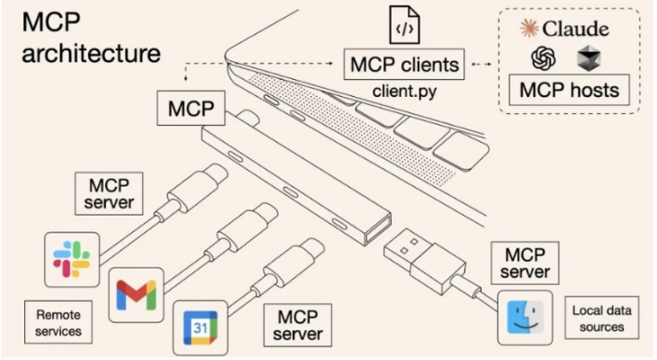

##### 技术架构

MCP采用"客户端- 服务器"的分布式架构，它将 LLM 与资源之间的通信划分为以下三个主要部分

- MCP Client：MCP Client是连接AI模型与MCP Server的客户端组件，它通常运行在AI应用、 IDE 或 Agent 系统中，主要负责与服务器建立连接、发现可用能力(Tools、Resources、Prompts)，同时负责将模型的工具调用请求转换为MCP协议消息并发送给服务器，另外负责接收服务器返回的数据或执行结果，再将这些信息整合进模型上下文中继续推理。它相当于AI的"调度与通信层"，负责协议交互、上下文管理以及必要的安全确认
- MCP Server：MCP Server是提供能力和数据的服务端组件，它主要负责向MCP Client暴露系统可用的资源和工具并在接收到调用请求时执行具体操作，例如：读取文件、查询数据库、调用API或运行命令等。它本质上是AI与真实系统之间的能力网关，内部通常包含工具注册、资源管理、执行引擎以及安全控制等模块，从而使AI能够通过标准协议访问外部系统
- Tools/Resources：Tools和Resources是MCP Server对外提供的具体能力单元，其中Tools表示可执行操作的功能接口，例如：运行命令、调用API、修改文件、查询数据库，通常会改变系统状态，Resources则表示可供模型读取的数据资源，例如：文件、文档、代码仓库或数据库记录，主要用于为模型提供上下文信息而不直接执行操作。Tools和Resources二者共同构成AI可访问的数据与功能集合，使模型能够在推理过程中获取信息并完成实际任务

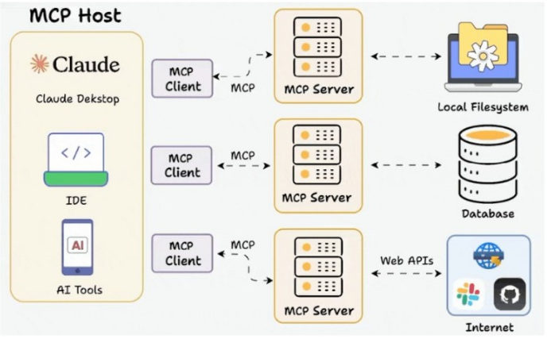

备注：MCP Host是指LLM启动连接的应用程序，例如：Cursor、Claude、Desktop、Cline

##### 核心组件

MCP的工作依赖三个核心组件：Resources、Tools、Prompts

###### Tools(工具)

在MCP中Tools是模型可以调用的可执行能力模块(类似函数调用)，它允许AI在推理过程中直接与外部系统交互，执行操作、处理数据或完成特定任务。Tools可以改变系统状态或触发操作，Tool通常包含以下信息：

- 工具标识Tool ID/Name)：唯一标识该工具，便于模型或MCP Client调用，例如：tool://search_docs、tool://run_shell_command
- 描述(Description)：说明工具功能和用途，例如："搜索文档库中的关键字" 或"在服务器上执行命令"
- 输入参数(Input Schema)：描述工具需要的输入数据格式和字段，例如：参数类型、必填项和默认值
- 输出结构(Output Schema)：工具返回数据的格式，使MCP Client能够将结果整合进模型上下文或后续流程
- 执行权限和约束(Permissions/Security)：指定谁可以调用工具以及调用工具是否需要额外认证，例如：只允许特定角色或在沙箱环境中运行
- 示例调用模板(Optional)：工具会提供默认调用方式或示例，便于模型正确构建调用请求

###### Prompts(提示词)

在MCP中Prompts是用于规范AI模型行为和任务执行流程的标准化模板，它的主要作用是为模型提供明确的指令和上下文格式，让模型在执行任务时能够按照预期的方式组织信息、调用资源和工具并生成结构化输出，通过Prompts，AI模型不仅知道要做什么，还知道如何做，Prompt通常包含以下几个关键信息

- Prompt ID/名称：唯一标识该提示词，便于复用和调用，例如：prompt://code_review、prompt://generate_summary
- 描述(Description)：简要说明提示词用途和适用场景，例如: 用于对代码文件进行审查，输出问题和优化建议
- 输入要求(Input Schema)：描述模型执行任务所需的数据格式或上下文信息，例如：哪些Resources需要被引用，例如：{"resources": ["resource://filesystem/src/main.py"], "user_prompt": "string"}
- 输出格式(Output Schema)：指定模型生成结果的结构或格式，便于后续工具调用或系统处理，例如： JSON 、Markdown、列表或文本块
- 默认行为或模板指令：具体的提示词文本或模板，指导模型如何处理输入、分析资源、调用工具，可以包含占位符，例如：{resource_content}或{user_question}，在运行时由MCP Client填充实际数据

简易示例：

```javascript
{
  "id": "prompt://code_review",
  "description": "对源代码文件进行审查，输出问题和改进建议",
  "input_schema": {
    "resources": ["resource://filesystem/src/main.py"],
    "user_prompt": "string"
  },
  "output_schema": {
    "issues": "list",
    "suggestions": "list"
  },
  "template": "请阅读以下代码文件内容：{resource_content}。基于最佳实践指出潜在问题，并提出改进建议。"
}
```

###### Resources(资源)

Resources是MCP中用于向模型提供上下文数据的组件，其本质上是可访问的静态/动态数据。它们通常用于向AI模型提供必要的信息，例如：本地文件、代码仓库、文档 知识库 、数据库表、配置文件、API返回的数据等，Resources的核心特点是"只提供数据，不执行操作"，因此Resources通常不会直接改变系统状态，而是为模型提供额外的上下文，Resources使用统一的资源标识符的形式进行访问，例如：

MCP中的每个Resource通常都包含以下信息：

(1) 资源标识

MCP的每个资源都有唯一URI地址来定位资源，格式如下：

```javascript
# 常见格式
resource://<provider>/<path>

# 简易示例
resource://filesystem/src/main.py
resource://docs/project_guide
resource://database/orders

# 备注说明
- provider：表示资源提供方或来源类型，例如：filesystem、docs、database
- path：表示资源在该提供方下的具体路径或标识
```

(2) 元数据(Resource Metadata)

Resource还包含元数据，它们主要用于描述资源的属性和用途，方便模型理解资源内容和访问方式，同时元数据还能用于权限控制、审计和优化访问策略，常见元数据包括：

- 名称(name)：资源的可读标识
- 大小(size)：资源内容长度或条目数量
- 类型(type)：文本、代码、数据库表、日志、API等
- 访问权限(permissions)：可读、只读或受限
- 创建/修改时间(created_at/updated_at)：资源更新历史
- 描述信息(description)：简要说明资源的主要用途或内容

简易示例：

```javascript
{
  "name": "project README",
  "type": "text",
  "size": "3KB",
  "created_at": "2026-03-10T10:00:00Z",
  "updated_at": "2026-03-10T12:00:00Z",
  "permissions": "read-only",
  "description": "项目的 README 文件，包含项目概览和使用说明"
}
```

(3) 资源内容(Resource Content)

资源内容是Resource的核心部分，表示资源实际包含的数据，MCP Client请求资源时，MCP Server会将资源内容返回给客户端，然后客户端会将其加入模型上下文，使模型能够基于这些数据进行推理。例如：在 代码分析 场景中模型可能读取resource://filesystem/src/main.py的内容并根据代码结构进行解释或修改建议，常见的资源内容包括：

- 文档资源中的文本内容
- 源代码文件中的代码
- 数据库表中的记录信息
- 日志文件 中的日志信息

(4) 访问控制信息(Access Control）

MCP通常会在Resource中包含权限或访问控制信息，用于限制模型或用户的访问行为，常见的访问控制字段包括：

- permissions：访问权限，例如：read-only、restricted等
- visibility：资源可见性，例如：public或private
- allowed_roles：允许访问的用户角色

简易示例：

```javascript
{
  "permissions": "read-only",
  "visibility": "private",
  "allowed_roles": ["developer", "admin"]
}
```

##### 工作流程

MCP的工作流程如下所示：

- 第1步：建立连接，MCP客户端和MCP服务器建立连接
- 第2步：客户端和服务器之间确认沟通规则，验证双方能否协商工作
- 第3步：客户端发问服务器，有哪些可用的工具和资源等，服务器返回工具、资源、提示清单
- 第4步：LLM接受用户请求后思考，决定用哪个工具并传入参数
- 第5步：客户端把LLM的请求转换成标准格式，发送给服务器
- 第6步：服务器开始调用外部系统，执行操作
- 第7步：服务器告诉客户端，客户端告诉LLM，操作已经完成了，上下文更新，结果返回

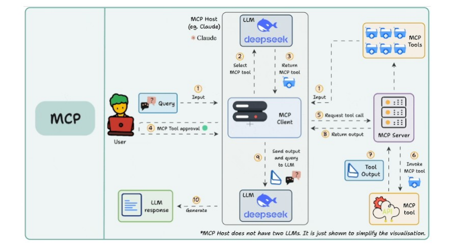

##### 通信机制

###### 架构概览

MCP的通信架构示意图如下所示：

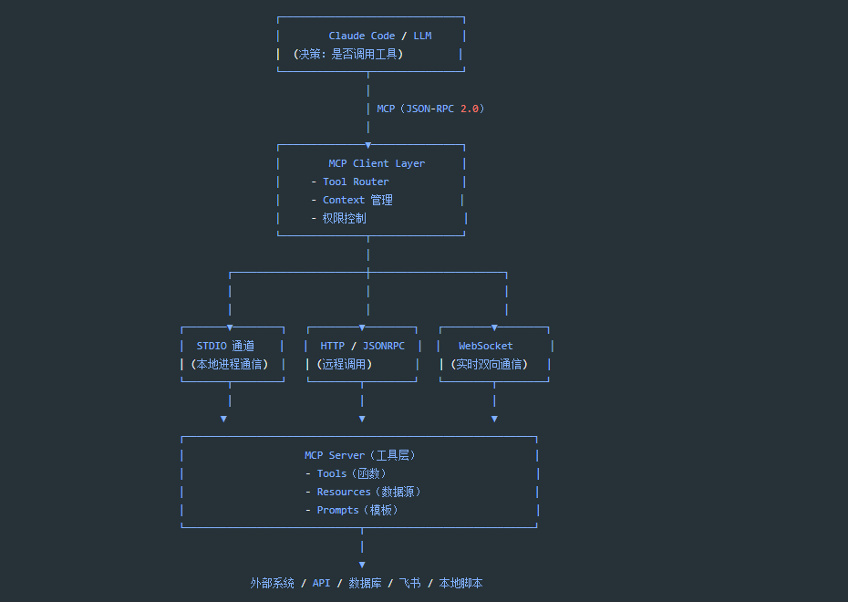

###### 通信方式

MCP通信协议统一(JSON-RPC），但是传输方式不同，目前主要有以下几种：

###### STDIO类型

STDIO(Standard Input / Output)是MCP默认、也是最核心的通信方式，它通过父子进程之间的标准输入输出流来传输JSON-RPC消息，LLM运行环境作为父进程启动MCP Server子进程并通过stdin向其发送请求(例如:tools.call)，Server再通过stdout返回响应，整个过程无网络、低延迟、强隔离，整个过程就像USB直连电脑——直接插入就能用，不需要网络，但是要求输出必须是纯净JSON(不能混入日志)，因此STDIO本质上是一种"本地进程级RPC通道"，适用场景包括：本地工具/插件/开发调试、隐私数据处理

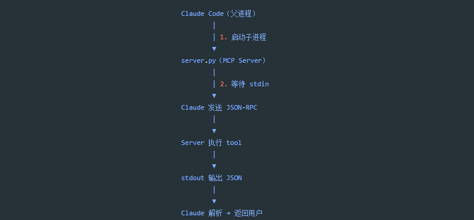

示例配置：

```javascript
{
  "mcp-demo": {
    "type": "stdio",
    "command": "python",
    "args": ["weather_server.py"]
  }
}
```

###### SSE通信方式

在MCP中SSE(Server-Sent Events)是一种基于HTTP的单向流式通信机制，它是由服务端持续向客户端推送数据，适用于模型调用过程中的实时响应与增量输出场景，它与STDIO这种本地进程间通信方式不同，SSE更适合远程部署的MCP服务-客户端通过建立一个长连接(通常是HTTP/HTTPS)订阅服务端事件流，服务端则以事件(event)和数据(data)的形式持续发送消息，例如：模型推理过程中的分段结果、状态更新或日志信息，SSE的优势在于实现简单(基于标准HTTP，无需复杂握手)、天然支持流式输出、易于穿透 防火墙，但其通信是单向的(服务端→客户端)，因此通常需要结合额外的请求接口(例如：REST API)来实现完整的请求-响应交互模式，目前官方已经弃用，在MCP最新规范中HTTP+SSE已被Streamable HTTP替代

###### Streamable HTTP

在MCP(Model Context Protocol)中，Streamable HTTP是新一代推荐的通信方式，用于替代已被弃用的SSE模式，它基于标准HTTP构建，同时兼顾“请求-响应”和“流式输出”两种能力。客户端通常通过HTTP POST发送请求，服务端可以选择一次性返回完整结果或在需要时通过流式响应(例如：分块传输或事件流)持续返回中间结果，从而实现类似实时推理输出的效果，Streamable HTTP与传统SSE相比不再依赖单一长连接，而是采用更灵活的交互模型，既支持双向通信(客户端请求+服务端流式响应)，又更易于集成现有的认证、网关、 负载均衡 等 云原生 基础设施，因此在稳定性、安全性和扩展性方面更适合现代 AI Agent 和企业级应用场景，Streamable HTTP就像高速公路，所有车都走同一个入口且支持普通模式和流式模式

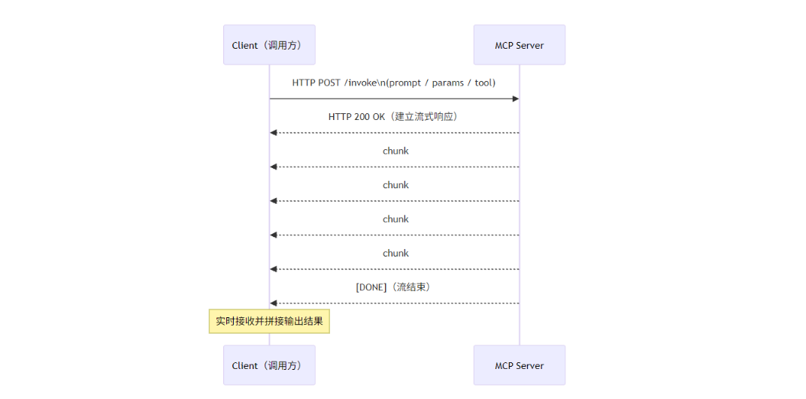

示例配置如下：

```javascript
{
  "mcp-demo": {
    "type": "http",
    "url": "https://example.com/mcp"
  }
}
```

##### 简易示例

##### Step 1：安装依赖

```javascript
pip install mcp
```

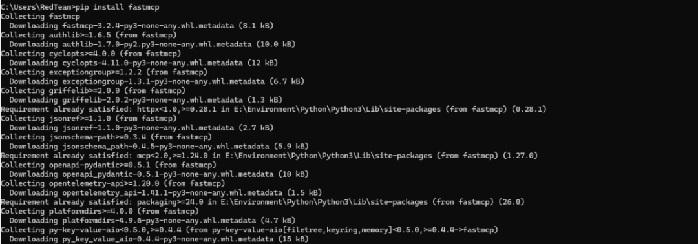

Step 2：编写MCP Server

```javascript
# coding: utf-8

from fastmcp import FastMCP
from datetime import datetime
from fastmcp.prompts import Message

mcp = FastMCP("mcp-demo")

@mcp.tool()
def get_current_time() -> str:
    """获取当前时间"""
    return datetime.now().strftime("%Y-%m-%d %H:%M:%S")

@mcp.tool()
def echo_message(message: str) -> str:
    """回显消息"""
    return f"Echo: {message}"

@mcp.tool()
def calculate(a: int, b: int, operation: str) -> str:
    """简单计算器，支持 + - * /"""
    ops = {"+": a + b, "-": a - b, "*": a * b}
    if operation == "/" and b != 0:
        return str(a / b)
    if operation in ops:
        return str(ops[operation])
    return "Invalid operation"

@mcp.tool()
def get_server_info() -> dict:
    """获取服务器信息"""
    return {"name": "mcp-demo", "version": "1.0.0", "tools": 4, "resources": 5, "prompts": 2}

@mcp.resource("resource://server-info")
def get_server_info_resource() -> dict:
    """服务器信息资源"""
    return {"name": "mcp-demo", "version": "1.0.0", "tools": 4, "resources": 4, "prompts": 2}

@mcp.resource("resource://tools-list")
def get_tools_list_resource() -> dict:
    """可用工具列表资源"""
    return {
        "tools": [
            {"name": "get_current_time", "description": "获取当前时间"},
            {"name": "echo_message", "description": "回显消息"},
            {"name": "calculate", "description": "简单计算器"},
            {"name": "get_server_info", "description": "获取服务器信息"}
        ]
    }

@mcp.resource("resource://config")
def get_config_resource() -> dict:
    """服务器配置资源"""
    return {"transport": "stdio", "max_connections": 10, "timeout": 30}

@mcp.resource("resource://greeting/{name}")
def greeting_template(name: str) -> str:
    """个性化问候模板"""
    return f"Hello, {name}! Welcome to MCP Demo Server."

@mcp.prompt
def welcome_prompt(name: str = "User") -> str:
    """生成欢迎消息"""
    return f"Please welcome {name} to the MCP Demo Server! Ask me anything."

@mcp.prompt
def code_review_prompt(code: str = "") -> list[Message]:
    """代码审查提示"""
    return [
        Message("Please review the following code and provide feedback:"),
        Message(code, role="user")
    ]

if __name__ == "__main__":
    mcp.run()
```

Step 3：在Claude Code的MCP配置文件中进行配置

```javascript
"mcpServers": {
  "mcp-demo": {
    "type": "stdio",
    "command": "E:\\Environment\\Python\\Python3\\python.exe",
    "args": [
      "C:/Users/RedTeam/Desktop/MCPTest/weather_server.py"
    ]
  }
}
```

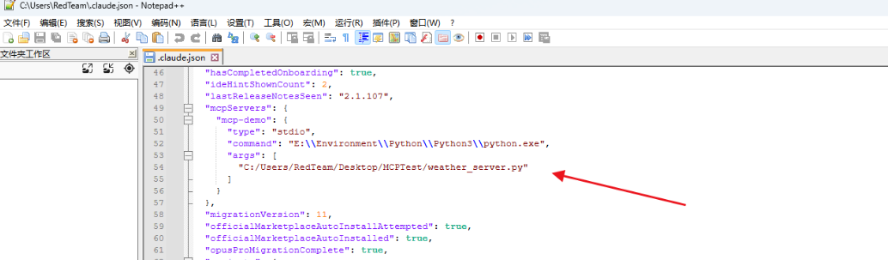

Step 4：启动Claude Code并执行"/mcp list"来查看有那些mcp

```javascript
/mcp list
```

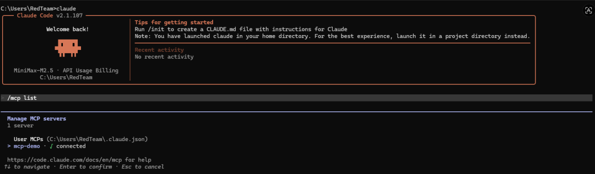

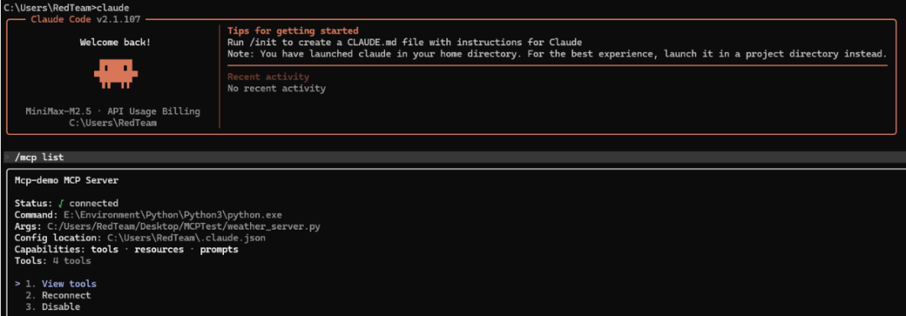

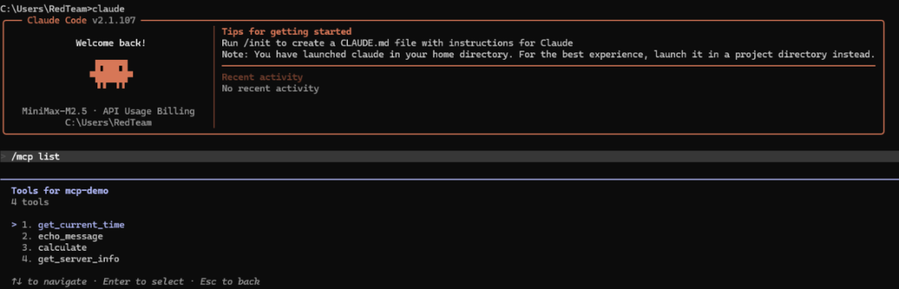

或者我们也可以提问

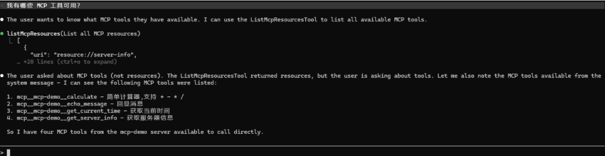

Step 5：调用MCP的tools来执行相关的操作

```javascript
使用mcp__mcp-demo__calculate 计算 120*5 =？
```

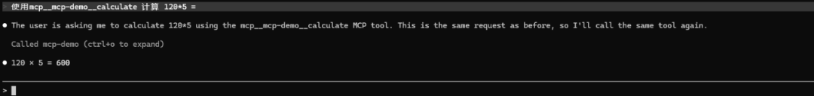

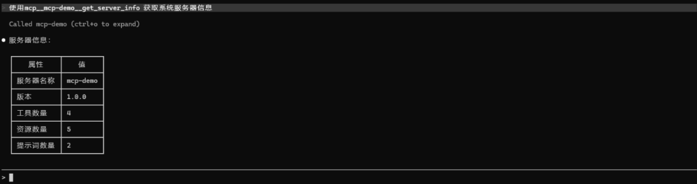

##### 文末小结

在快速演进的AI生态中，MCP(Model Context Protocol)为模型与外部工具、数据源之间建立了一种清晰、标准化的连接方式。通过本文的介绍，我们从概念、通信机制到实际应用场景，对MCP的核心能力有了系统性的认识：它不仅解决了模型“如何获取上下文”的问题，更为构建可扩展、可组合的AI应用提供了基础设施级的支撑，从工程实践角度来看MCP的价值不在于"替代现有架构"，而在于解耦模型与工具之间的交互复杂度。无论是通过STDIO方式快速集成本地服务，还是通过更复杂的服务化部署实现企业级扩展，MCP都提供了一条统一而灵活的路径。这使得开发者可以更加专注于业务逻辑本身，而不是被繁琐的接口适配和上下文拼接所困扰

##### 参考链接

https://github.com/modelcontextprotocol

https://modelcontextprotocol.io/docs/getting-started/intro

https://www.dailydoseofds.com/model-context-protocol-crash-course-part-4/

https://www.dailydoseofds.com/p/visual-guide-to-model-context-protocol-mcp/
