## 参考超链接：
https://zhuanlan.zhihu.com/p/1922641762163340954

## 正文：

在人工智能领域，大语言模型（LLM）的应用越来越广泛。但它并非万能，能力边界逐渐显现。怎么让 AI 真正“用工具”，获取实时数据，执行复杂任务？MCP（模型上下文协议）应运而生。本文 AiBot 研究社将用通俗易懂的语言，揭开 MCP 的神秘面纱。

你有没有想过，为啥现在的智能助手越来越机灵，能帮你查天气、发邮件，连写文章都不在话下？其实啊，这多亏了一项超神奇的技术——**MCP（模型上下文协议）**，是它让 AI 变得又强又好用。最近我在网上刷了好多 MCP 相关的视频和文章，感觉有点头绪，可又好像没彻底搞懂。

作为 AI 学习的新手，我打算用最直白易懂的方式，聊一聊我理解的这些事儿：MCP 到底是啥？为啥它近来这么火？API、Function Calling 和 MCP 这仨到底啥关系？还有，咋去找别人已经做好的 MCP 服务工具。希望这篇文章，能帮你弄懂这些看着高深的技术概念。

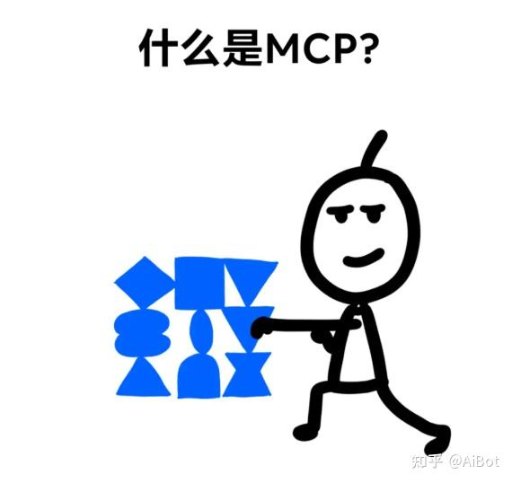

## 一、什么是 MCP？

**MCP**，全名是 **Model Context Protocol（模型上下文协议）**，这是 Anthropic 公司在 2024 年 11 月 26 日推出的技术协议。**MCP 旨在定义一套通用通信规则**，借助这套规则，AI 助手就能连接外部资源，让给出的回应更准确、更好用。

现在，越来越多企业都采用这个协议，它已然成为 LLM 使用工具领域实际的标准，进一步挖掘出 AI 智能体的发展潜力。

## 二、大模型为什么需要 MCP 服务？

### 1、大模型的能力边界

像 GPT、Claude 这类大语言模型（LLM），确实厉害，不管是写文章还是写代码，都能轻松应对，能理解和生成各种自然语言内容。然而，它们的能力也存在明显边界：

- **被动处理文字**：模型只能处理输入的内容，没办法主动去搜寻最新信息、访问数据库，更没法操作现实世界的工具。
- **知识有时效局限**：模型的知识储备截止到训练之时，像最新的天气、新闻或者股票价格这类实时数据，它获取不到。
- **容易“编造”答案**：遇到不懂的问题，模型不会坦诚说“不知道”，而是会“编造”答案，在 AI 领域，这被叫做“幻觉”。
- **复杂能力有限**：对于复杂的多步任务以及追踪历史数据等方面，模型的能力比较欠缺。

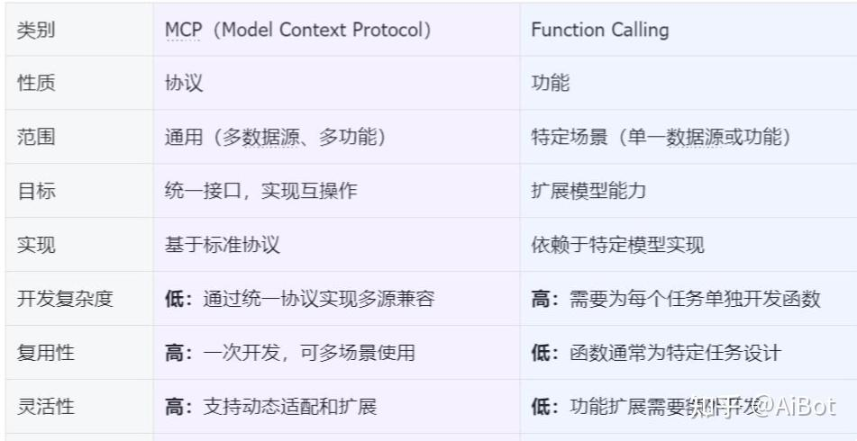

### 2、Function Calling（函数调用）

针对大模型这些能力短板，2023 年 6 月，OpenAI 等公司推出了 Function Calling。借助它，AI 能把需求转化为结构化指令，交给外部服务去执行。不过，这种方式也存在一些问题，各个公司的实现方式不一样，开发和维护成本高，工具一多，扩展起来相当困难。

- **Function Calling 原理**：举个例子，AI 可以把“查北京天气”这样的请求，转化成结构化的函数调用（类似 API），然后由外部工具来完成实际的查询操作。
- **优点**：如此一来，AI 能够获取实时数据、实现任务自动化，还能访问数据库，能力得到显著增强。
- **局限**：
  - **逐个对接工具**：每增加一个新工具，开发者就得专门编写一套集成代码，维护起来相当繁琐。
  - **标准不统一**：不同 AI 厂商和工具的接口格式、参数以及返回值都不一样，这大大增加了开发和扩展的难度。
  - **复杂场景应对无力**：面对多步任务、多个工具协作以及复杂数据结构的情况，Function Calling 很容易陷入混乱，出错概率较高。
  - **安全权限管理难题**：调用外部工具涉及数据安全和权限控制，在 Function Calling 方案下，很难做到统一管理。

早期的大模型尽管强大，但在“使用工具”方面，能力有限，集成过程复杂，维护也困难重重。Function Calling 虽然是一大进步，可依然没有解决标准化和大规模扩展的问题，就好像 AI 的潜力被“工具孤岛”给限制住了。

而 MCP 的诞生，恰似 AI 世界里的“USB-C”接口。有了它，所有工具与 AI 之间都能依据同一标准实现连接。如此一来，集成难度大幅降低，同时，AI 的能力边界也得到了极大的拓展。

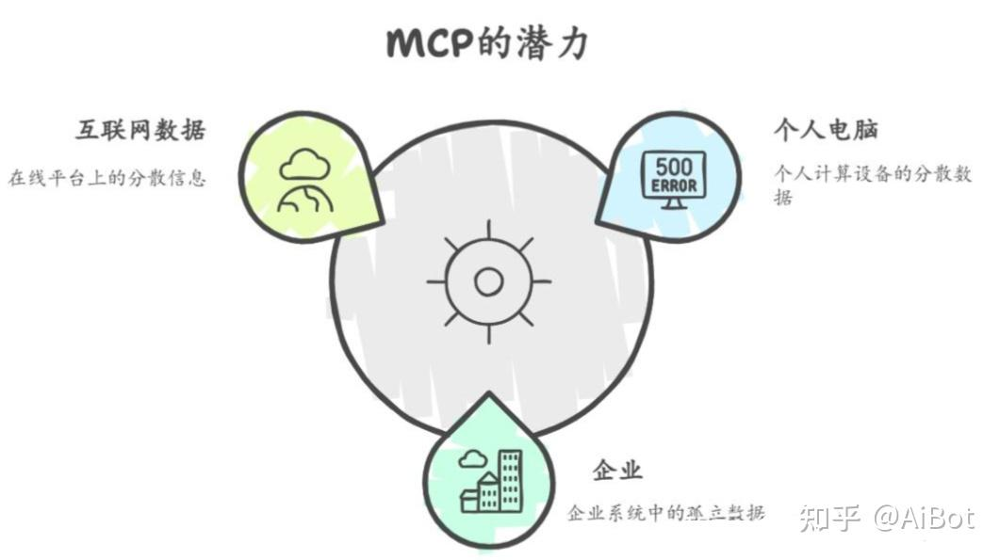

## 三、API、Function Calling、MCP 三者区别？

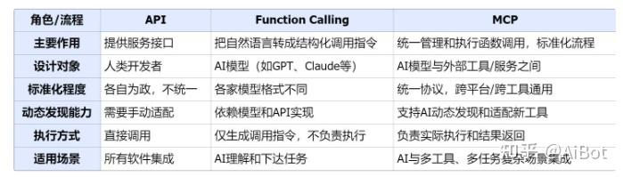

下面用快递比喻理解差异（代码对比）。

**传统 API 调用方式**

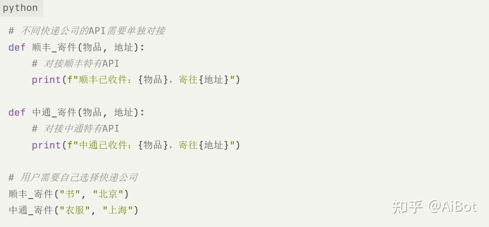

**Function Calling 实现**

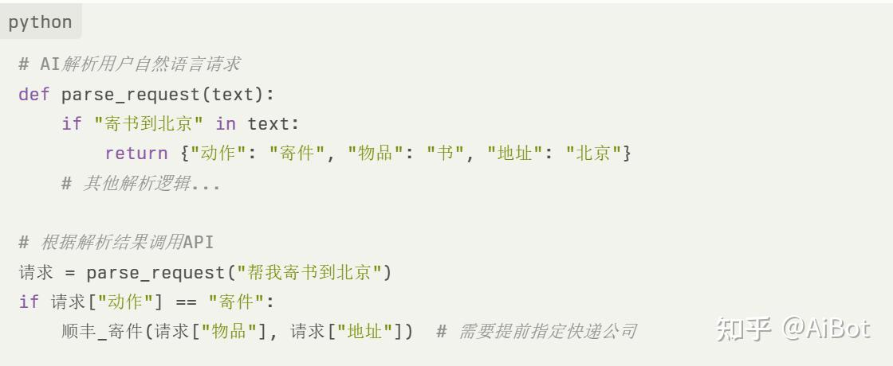

**MCP 标准化实现**

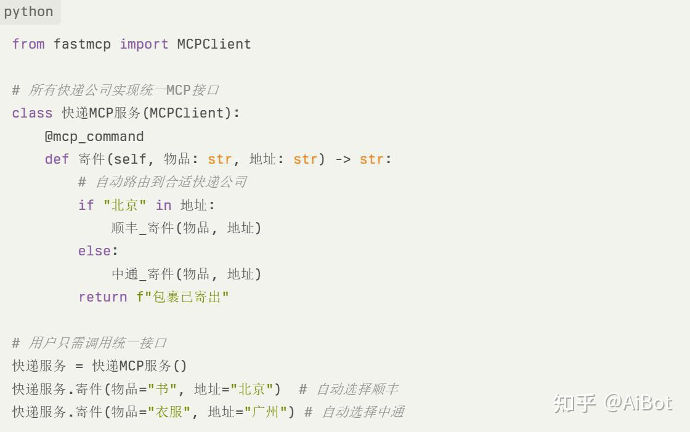

## 四、如何使用 MCP

MCP 就好比一个“标准插座”，它可不是什么具体的软件，而是一种能让 AI 与工具顺畅交流的“通用语言”。要知道，MCP 仅仅是个协议，没办法直接拿来用，得先去实现它。咱们先来了解下 MCP 的基本架构，也就是它的三大角色。

**MCP Host（宿主 / 主程序）**：像 Claude Desktop、Cursor、Cline、Cherry Studio，还有 AI 助手、带 AI 功能的 IDE 这些都很常见。Host 主要负责跟用户打交道。

**MCP Client（MCP 客户端）**：它镶嵌在主程序里头，专门负责和 MCP Server 进行沟通。

**MCP Server（MCP 服务器）**：每个服务器都连接着一个特定工具，像 GitHub、数据库、天气服务之类的，然后通过 MCP 协议把自身功能“展现”出来。

还有传输层，MCP 支持两种连接方式，本地（STDIO）和远程（HTTP + SSE）。这样一来，不管工具在你自己电脑上，还是在云端，都能轻松连接上。

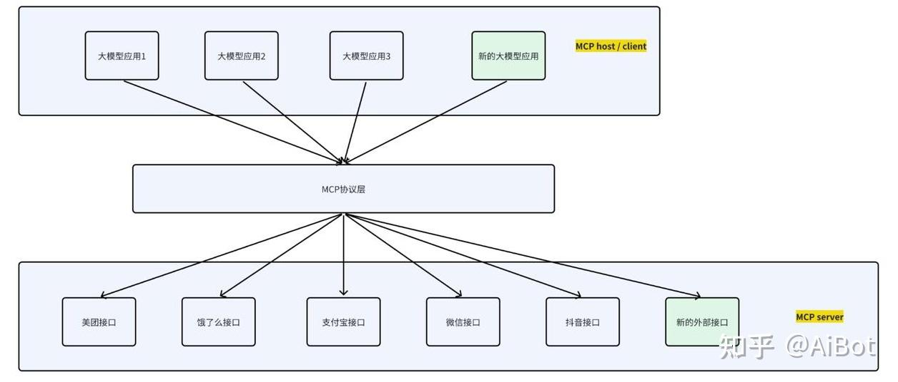

例子辅助理解：把 MCP 想象成智能家居系统

- Host = 手机上的智能家居 APP
- Client = 每个家电的智能插座
- Server = 家电本身（空调 / 灯光 / 电视）
- MCP 协议 = 统一的智能家居通信标准

可以想象一下，你用手机 APP（这就是 Host）去打开空调（Server），这时智能插座（Client）会自动把你的指令转化成标准协议。空调收到指令后就开始工作，并把状态反馈回来。这意味着，以后任何新家电，只要支持这个标准，就跟即插即用的设备一样，你的 APP 能自动识别它，还能轻松控制，根本不用再去学习新的操作方法，也不用针对每个品牌单独进行适配。

**MCP Server 能让 AI 通过三种方式来帮你干活：**

- **资源（Resources）**：比如说查文件、查数据，AI 可以帮你读取里面的内容。
- **工具（Tools）**：像“帮我发邮件”“查天气”“新建任务”这类需求，AI 能直接执行这些功能，这个功能可是最常用的哦，就相当于可以被 LLM 调用的函数。
- **提示（Prompts）**：AI 还能用一些提前设定好的模板，帮你写文章、做总结，甚至生成代码。

这里要划重点啦：最常用的就是“工具”功能，它能让 AI 实实在在地帮你“做事”！

MCP 就好比一个智能插线板，AI 助手和各种工具都能用同一个“插头”连接起来。当你通过 AI 助手（Host）发出请求，MCP Client 就负责把这个请求传递出去，MCP Server 再把请求转化成工具能理解的操作，最后把结果传回来。如此一来，AI 就能帮你查天气、管理文件、连接数据库，几乎什么都能做啦！

## 五、怎么找到别人已经写好的 MCP 服务工具

如今，已经涌现出不少专门的 MCP 服务市场，它们如同一个大集合，汇聚了形形色色的 MCP 工具与插件，就跟应用商店差不多，你随时都能去查找并接入。下面给大家讲讲几个最常用的 MCP 服务市场。

### 1、mcp.so

mcp.so 称得上是当下颇受欢迎的 MCP 服务市场，这里面收纳了众多开源以及商业性质的 MCP 插件，涉及的场景极为广泛，从天气查询、翻译工作，到办公自动化、生活服务等，无所不包。

适合人群：无论是刚接触的小白用户，能在这里直接搜索并体验各类功能；还是开发者，都可以上传自己开发的 MCP 服务。

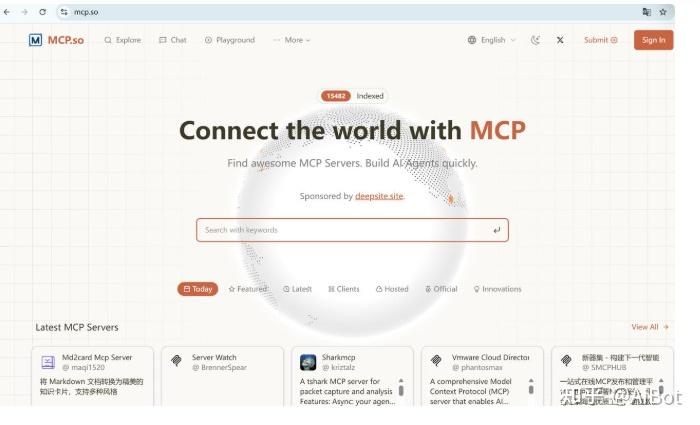

### 2、mcpmarket.com

mcpmarket 更像是一个 MCP 服务的“导航站”，聚合了全球各地的热门 MCP 工具，支持按分类、评分、更新时间等多种方式筛选。

适合人群：想要对比不同服务、寻找高质量插件的用户。

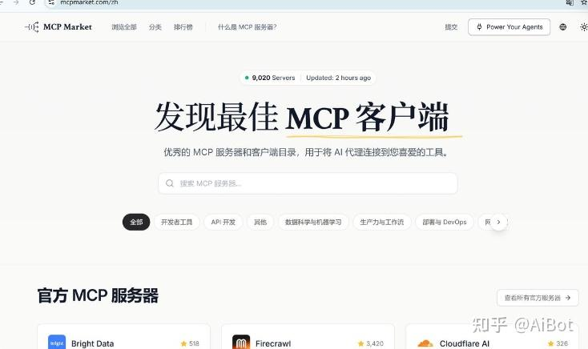

### 3、smithery.ai

smithery.ai 主打创新型和专业型 MCP 服务，收录了许多面向企业和开发者的高级插件，比如数据分析、自动化办公、AI 写作等。

适合人群：对功能有更高要求、希望集成到自己工作流中的进阶用户。

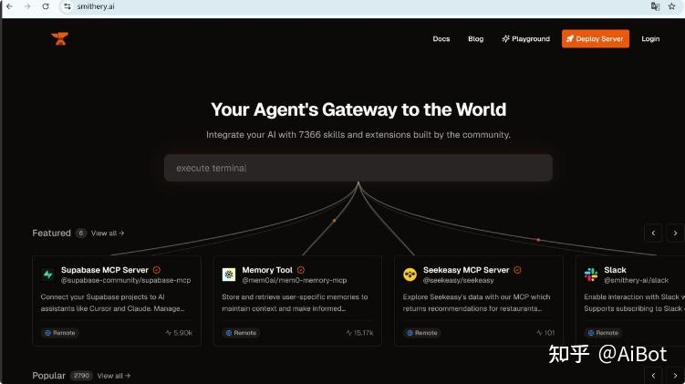

### 4、mcpworld

mcpworld 是百度搜索开放平台旗下，聚合了海量可用的 MCP Servers。

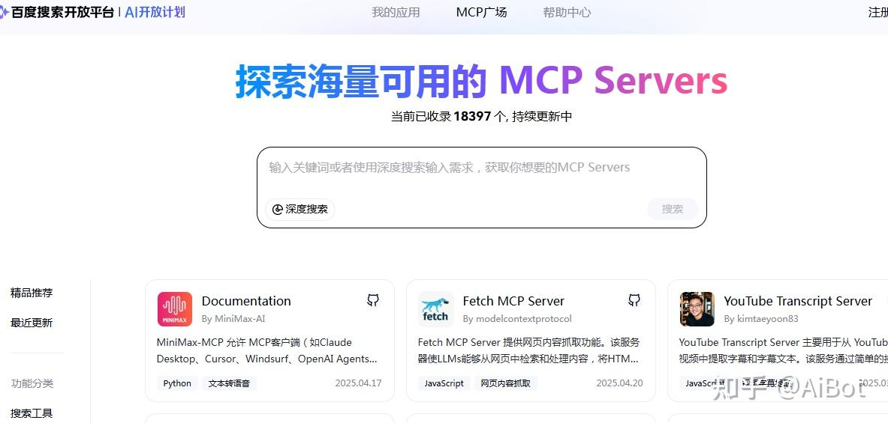
