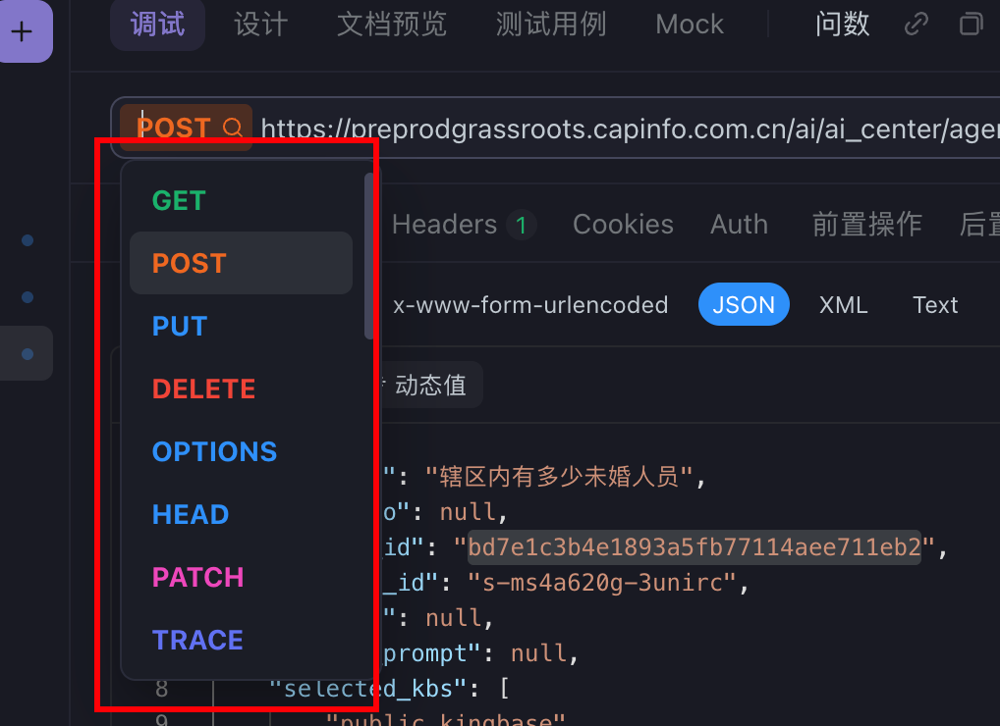
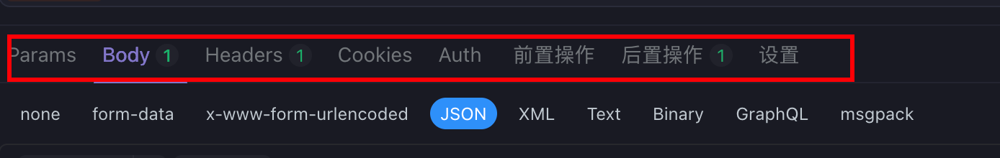

## 1. 请求方法：截图中的 GET、POST 等是什么意思？

红框内是 **HTTP 请求方法（Method）**，用于表达这次请求要对服务器上的资源做什么。可以把 URL 理解为“访问哪个地址”，把请求方法理解为“要做什么操作”。

**调试已有接口时，按接口文档选择方法。** 不能因为自己想查数据，就把文档要求的 POST 改成 GET；同一个 URL 配合不同的方法，也可能对应不同的接口。方法选择入口位于请求 URL 左侧，参见 [Apifox：请求 URL 与方法](https://docs.apifox.com/5220199m0)。

以下路径和数据均为教学示例，实际参数以你的接口文档为准。

### 1.1 GET：获取数据

可以理解为：“把这份信息给我看看。”

- 常见用途：查询用户详情、列表、任务状态。
- 示例：`GET /users/123`，查询编号为 123 的用户。
- 筛选、分页条件通常放在 URL 查询参数中，例如 `GET /users?page=1&size=10`；在 Apifox 的 Query 参数区域填写。
- 按标准语义，GET 不应承担修改业务数据的操作。GET 请求体没有通用定义，不要按 POST 的习惯给 GET 填 JSON Body。

### 1.2 POST：提交数据，让服务器处理

可以理解为：“这些数据交给你，请按接口约定处理。”

- 常见用途：创建用户、提交表单、登录、发起 Agent 对话或执行任务。
- 示例：`POST /users`，提交新用户信息；`POST /agent/chat`，提交问题和会话信息。
- 数据常放在 Body 中，格式可能是 JSON、表单或文件，按接口要求选择。
- **POST 不只表示新增。** 复杂查询、文本生成也可能使用 POST，不能仅凭业务名称判断方法。

### 1.3 PUT：整体替换资源，也可在指定地址创建资源

可以理解为：“把这个地址上的资源设成我提交的样子。”

- 常见用途：整体更新用户资料或配置。
- 示例：`PUT /users/123`，提交该用户新的完整可写信息。
- 与局部修改相比，PUT 强调整体替换。遗漏字段如何处理，要看接口约定，不能默认遗漏就代表保留原值。
- 如果目标资源不存在，服务端也可能允许通过 PUT 在该地址创建资源。

### 1.4 DELETE：删除资源

可以理解为：“请删除这个资源。”

- 常见用途：删除用户、文件、会话或任务记录。
- 示例：`DELETE /conversations/123`，删除编号为 123 的会话。
- 实际是物理删除还是标记删除，由后端实现决定。
- 不要仅用“响应是否有正文”判断成功；删除成功时，接口可能返回 `204 No Content`。

### 1.5 OPTIONS：询问接口支持哪些操作

可以理解为：“这个地址允许怎样访问？”

- 示例：`OPTIONS /users/123`，查询该资源的通信选项。
- 响应可能通过 `Allow` 告知支持的方法，例如 `GET, HEAD, PUT, DELETE, OPTIONS`。
- 浏览器的 CORS 跨域预检也会使用 OPTIONS，检查是否允许某个来源、方法和请求头；这时会涉及 `Access-Control-Allow-*` 等响应头。
- 普通业务调试一般不需要先手动发送 OPTIONS；它也不是获取业务数据的方法。

### 1.6 HEAD：获取响应信息，不返回响应正文

可以理解为：“告诉我这份内容的情况，先不用把正文发过来。”

- 类似 GET，但只接收状态码和响应头，没有响应正文。
- 示例：`HEAD /files/report.pdf`，查看文件的响应信息。
- 常用于查看资源是否可访问，以及服务端提供的 `Content-Type`、`Content-Length`、`Last-Modified` 等元信息；具体有哪些头取决于服务端。
- **HEAD 不是填写请求头。** Apifox 的 `Headers` 是请求配置区域，GET、POST 等方法同样可以配置请求头。

### 1.7 PATCH：局部修改资源

可以理解为：“只按这份修改说明调整资源。”

- 常见用途：修改昵称、更新状态或配置中的部分字段。
- 示例：`PATCH /users/123`，只修改昵称。
- 如果接口约定接受普通 JSON 对象，请求体可以是 `{"nickname":"小林"}`；也有接口要求 JSON Patch 等专用格式，必须按接口文档填写。
- **PUT 强调整体替换，PATCH 强调局部修改。** PATCH 的标准定义参见 [RFC 5789](https://www.rfc-editor.org/rfc/rfc5789.html)。

### 1.8 TRACE：回显请求，辅助诊断

可以理解为：“把你收到的请求回传给我看看。”

- 用于诊断 HTTP 请求经过中间环节后是否被修改。
- 普通业务接口测试很少使用，实际服务也可能不开放这个方法。
- TRACE 不是查看 Agent 思考过程、业务日志或调用链的开关。

以上方法的基本含义可对照 [Apifox：HTTP 接口](https://apifox.com/help/api-design/http-api)。

## 2. 请求配置：Params、Body、Headers 等是什么意思？

红框里是配置一次请求的不同入口。**它们可以配合使用，不是只能选一个。** 例如，一次 POST 请求可以同时带 URL 参数、JSON 请求体和认证信息。截图中当前打开的是 Body，所以下方显示的是请求体格式选项。

### 2.1 Params：填写 URL 参数

可以理解为：“地址里的哪些部分需要填值？”

- **Query（查询参数）**：位于 URL 的问号后，例如 `/users?page=1&size=10` 中的 `page` 和 `size`，常用于分页、筛选和排序。
- **Path（路径参数）**：位于路径中，例如 `/users/{userId}`，把 `userId` 填成 `123` 后，实际访问 `/users/123`。
- 在 Apifox 中按参数名称填写值，并确认需要发送的参数处于启用状态；路径参数的具体显示位置以当前界面为准。

**Params 不等于所有请求参数。** JSON 字段应填在 Body，请求头应填在 Headers。POST 同样可以带 Query 参数。参数位置由接口约定，不能随意互换。参见 [Apifox：新建接口中的请求参数](https://docs.apifox.com/create-an-api)。

### 2.2 Body：填写请求体

可以理解为：“这次要交给服务器处理的具体内容。”

例如，调用 Agent 时，问题、会话编号、知识库列表等可能放在 Body 中；上传文件时，文件也可能通过 Body 发送。具体字段和格式以接口文档为准。

下方的 JSON、form-data 等按钮用于选择 Body 格式，详见第 3 节。**这里填写的是发出去的内容，不是服务器返回的回答。**

### 2.3 Headers：填写请求头

可以理解为：“随请求一起附带的格式说明、凭证和其他元信息。”

常见例子：

- `Content-Type: application/json`：告诉服务器，本次发送的 Body 是 JSON。
- `Accept: text/event-stream`：告诉服务器，希望接收 SSE 事件流；是否返回仍取决于接口支持情况。
- `Authorization: Bearer {{token}}`：携带 Bearer 访问令牌；`{{token}}` 是变量引用，需要事先赋值。

**Content-Type 说明我发什么，Accept 表达我希望收什么。** 两者可以不同，例如发送 JSON、接收事件流。

Apifox 会根据 Body、Auth 等配置生成部分请求头，一般不必重复手填。若手动填写，注意不要与自动生成的值冲突。参见 [Apifox：请求头](https://docs.apifox.com/request-headers)。

### 2.4 Cookies：管理随请求发送的 Cookie

可以理解为：“服务器用来识别会话等状态的小段数据。”

例如，登录接口返回 `Set-Cookie`，后续请求通过 `Cookie` 携带会话标识，服务器便可以识别登录状态。

Apifox 支持保存登录响应中的 Cookie，并在后续匹配的请求中自动携带；是否发送还受域名、路径、有效期及相关设置影响。**Apifox 的 Cookie 不等于浏览器当前的登录状态**，浏览器里已登录，并不代表 Apifox 也已登录。

### 2.5 Auth：配置认证与授权凭证

可以理解为：“这次以什么身份访问接口？”

- **Bearer Token**：使用访问令牌。选择此类型后，Token 输入框通常只填写令牌值或 `{{token}}`，无需再手动加 `Bearer ` 前缀。
- **Basic Auth**：填写用户名和密码，由工具生成对应认证信息。
- **API Key**：按接口约定设置密钥名称、值及发送位置，例如 Header 或 Query。
- **OAuth 2.0**：按服务方的授权流程获取并使用访问令牌。

Auth 是帮助你生成认证信息的配置入口；Headers 则可以直接填写最终请求头。例如，使用 Bearer Token 时，可在 Auth 中配置，也可在 Headers 中填写 `Authorization: Bearer {{token}}`，通常选一种即可，避免重复或冲突。

Cookie 与 Token 登录方式可参考 [Apifox：登录态如何处理](https://docs.apifox.com/5802184m0)。

### 2.6 前置操作：请求发送之前做准备

可以理解为：“发出去之前，先把数据准备好。”

常见用途：生成时间戳或随机测试数据、计算签名、设置变量、准备认证信息。例如，先设置变量 `request_time`，再在请求参数中引用 `{{request_time}}`。

这些是 Apifox 侧的准备操作，不是服务器内部的业务处理。自定义脚本只是前置操作的一种形式，参见 [Apifox：前置脚本](https://docs.apifox.com/pre-request-scripts)。

### 2.7 后置操作：收到响应之后检查或提取数据

可以理解为：“结果回来了，检查是否正确，再保存后面要用的值。”

常见用途：

- **断言**：自动判断状态码、业务字段是否符合预期。例如，检查状态码为 200，并进一步检查业务成功标志。
- **提取变量**：从登录响应中取出 Token 保存为变量，供下一次请求使用。
- **自定义脚本**：对返回数据做进一步处理。

例如，登录响应是 `{"data":{"token":"示例令牌"}}`，可通过后置操作提取 `$.data.token` 并保存到环境变量 `token`；后续请求的 Auth 再引用 `{{token}}`。实际提取路径要与响应结构一致。

前置操作负责准备输入，后置操作负责处理输出。后置操作不能修改已经发出的这一次请求。参见 [Apifox：前后置操作](https://docs.apifox.com/pre-post-processors)。

### 2.8 设置：调整请求发送行为

这里用于调整请求本身的行为，例如 URL 自动编码、SSL 证书验证等，而不是填写问题、用户编号等业务参数。具体选项以当前版本展开后的界面为准，截图没有展示这些选项。

初次调试一般保持默认值，再根据具体问题调整。请求超时等选项也可能位于应用右上角的全局设置中，不一定都在此页签。参见 [Apifox：自定义请求设置](https://docs.apifox.com/5220202m0) 和 [请求超时时间设置](https://docs.apifox.com/6062173m0)。

### 2.9 标签旁边的绿色数字是什么意思？

这些数字是对应区域的配置数量或内容状态提示，**不是 HTTP 状态码，也不表示执行成功**。例如，Headers 或后置操作旁的 `1` 提示该区域有对应配置项，可点进去查看。

仅凭截图不能判断这些配置具体是什么；尤其不能把 `Body 1` 直接理解为“JSON 只有一个字段”。判断最终发送的内容，应在发送后查看“实际请求”。

## 3. Body 下方各个格式是什么意思？

**按接口要求选择格式，不能只把内容粘进去就算完成。** 例如，相同的键和值放进 JSON、表单和 URL 参数中，服务端读取它们的方式可能不同。

- **none**：不发送请求体；仍可携带 URL 参数和请求头。
- **form-data**：分段表单，常用于“文件 + 普通字段”。例如 `file` 选择本地文件，`description` 填写说明，发送格式为 `multipart/form-data`。通常让工具生成包含 boundary（分段边界标识）的 Content-Type。
- **x-www-form-urlencoded**：把表单键值对编码后放在 Body 中，例如 `name=Lin&age=18`。看起来像 Query，但不在 URL 中，常用于普通表单提交。
- **JSON**：结构化数据，例如 `{"question":"你好","stream":true}`，适合对象、数组等数据，是 Agent 接口常见格式。
- **XML**：使用标签组织数据，例如 `<request><question>你好</question></request>`，常见于要求 XML 的接口。
- **Text**：发送原始文本，例如直接发送 `你好`。Content-Type 按接口要求配置，纯文本通常使用 `text/plain`。
- **Binary**：直接把文件的原始字节作为 Body，适用于要求直接上传文件内容的接口；与 form-data 包含多个表单字段的方式不同。
- **GraphQL**：提供 GraphQL 查询和变量的编辑入口，仅适用于支持 GraphQL 的接口；不是普通 REST 接口的通用替代选项。
- **msgpack**：使用 MessagePack 二进制格式表示结构化数据，只有服务端支持该格式时才使用。

以上格式的操作说明可参考 [Apifox：请求参数与请求体](https://docs.apifox.com/request-params-and-body)。

