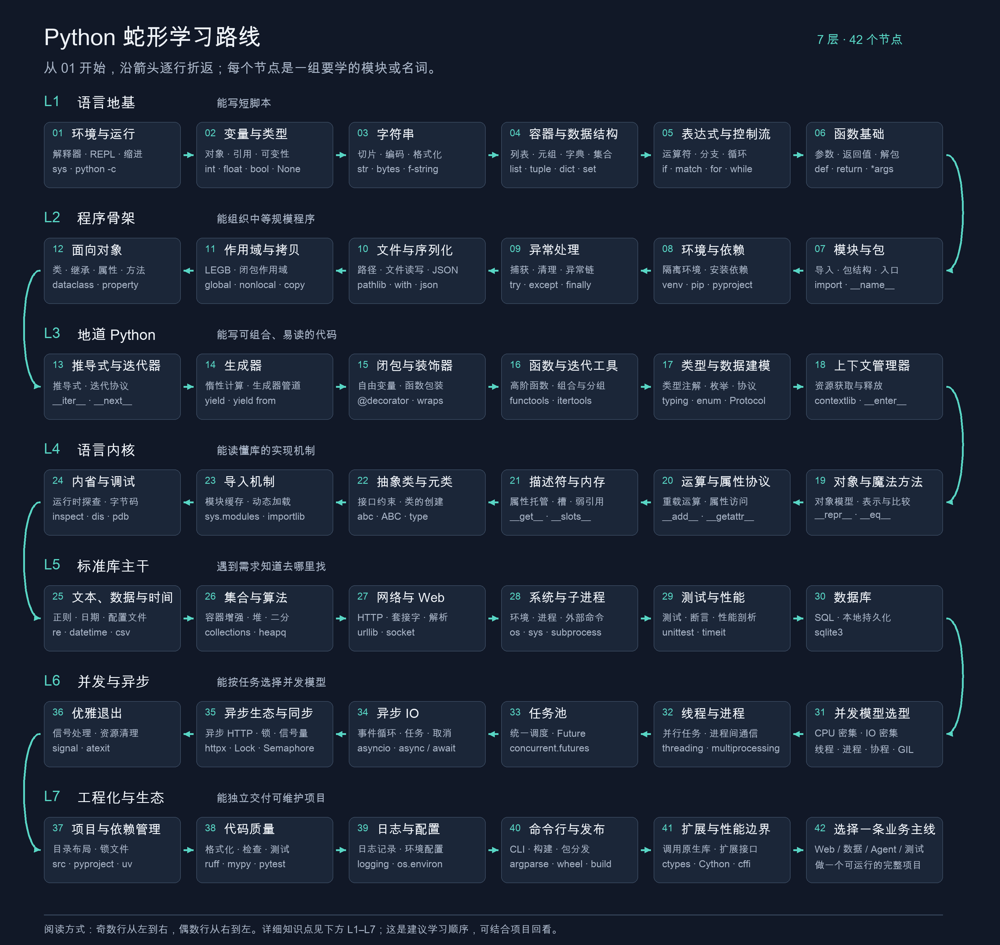

# Python 全景地图：从入门到完整掌握

**本篇目标**：给你一张「高屋建瓴」的目录——按从易到难排好，覆盖把 Python **当一门完整语言**真正吃透所需的全部能力层。

> 说明：没有人能「背完」标准库里每一个函数。所谓完整掌握，是指：
> 1. **语言本体**（语法、对象模型、执行模型）了然于胸；
> 2. **标准库主干**能按场景秒定位、熟练调用；
> 3. **工程与生态**能独立搭项目、查文档、解问题。
>
> 学完下列层级，你就具备「熟练掌握 Python」的完整能力画像。  
> 配套教程已按 L1–L7 分为七篇，章节编号与蛇形图的 01–42 节点对应。建议先沿路线学习，再按实际项目需要回查。

---

## 蛇形学习路线：从 01 开始

从左上角 **01「环境与运行」** 出发，沿箭头逐行折返：第一行从左到右，第二行从右到左，依次走到 **42「选择一条业务主线」**。每个节点对应一个学习主题，下方列出要认识的模块、工具或关键名词。



图中的节点是学习主题的归组，详细知识点见下方对应的 **L1–L7**。箭头表示建议学习顺序，不是严格的前置依赖；可以边做小项目边回看相关节点。

**配套教程入口**：

- **L1 · 01–06**：[1-语言地基](./1-语言地基.md)——语法、内置类型与短脚本。
- **L2 · 07–12**：[2-程序骨架](./2-程序骨架.md)——模块、依赖、异常、文件、作用域与面向对象。
- **L3 · 13–18**：[3-地道Python](./3-地道Python.md)——迭代、生成器、装饰器、函数工具、类型与上下文管理。
- **L4 · 19–24**：[4-语言内核](./4-语言内核.md)——对象协议、描述符、元类、导入与调试。
- **L5 · 25–30**：[5-标准库主干](./5-标准库主干.md)——文本、容器、网络、系统、测试与数据库。
- **L6 · 31–36**：[6-并发与异步](./6-并发与异步.md)——模型选择、线程与进程、任务池、异步与退出。
- **L7 · 37–42**：[7-工程化与生态](./7-工程化与生态.md)——项目管理、质量、日志、命令行、扩展与完整项目。

---

## 总览：七层能力模型

```text
L7  工程化与生态          ← 能独立交付可维护项目
L6  并发与异步            ← 能按任务选择并发模型
L5  标准库主干            ← 遇到需求知道去哪里找
L4  语言内核              ← 能读懂库的实现机制
L3  地道 Python           ← 能写可组合、易读的代码
L2  程序骨架              ← 能组织中等规模程序
L1  语言地基              ← 能写短脚本
```

由下往上：下面是地基，上面是楼层。跳层学可以，但遇到「为什么这样设计」会反复掉回下层。

---

## L1｜语言地基：语法与内置数据结构

**学习目标**：能独立写一个短脚本，完成输入、处理和输出；能解释变量引用的对象，以及修改容器时发生了什么。

| 节点 | 学习主题 | 要搞懂的点 | 关键模块 / 内置 / 语法 |
|------|----------|------------|------------------------|
| 01 | 环境与运行 | 解释器是什么；虚拟环境是什么、为何使用；`venv` 与 conda 的基本用法；脚本与 REPL 的区别；如何运行 `.py` 文件；缩进、注释与源码编码；如何读懂基本报错 | `sys`、`venv`、`python -c`、`print`、`input` |
| 02 | 变量与类型 | 赋值、对象与引用；动态类型；可变与不可变；整数、浮点数、布尔值和空值；类型转换、浮点精度与真值测试 | `int`、`float`、`bool`、`None`、`type`、`id`、`isinstance`；了解 `complex` |
| 03 | 字符串 | 索引与切片；查找、替换、分割与拼接；f-string 格式化；字符串不可变；文本与字节的区别、编码与解码 | `str`、`bytes`、`split`、`join`、`strip`、`encode`、`decode`、f-string |
| 04 | 容器与数据结构 | 列表与元组的区别；字典按键取值；集合去重与集合运算；增删改查、遍历、嵌套与解包；可哈希键；按场景选容器 | `list`、`tuple`、`dict`、`set`、`frozenset`、`len`、`sorted` |
| 05 | 表达式与控制流 | 算术、整除与取余；比较、成员和身份判断；布尔短路；条件分支、循环与循环 `else`；跳出与跳过；了解位运算及赋值表达式 | `if`、`elif`、`else`、`match`、`for`、`while`、`break`、`continue`、`and`、`or`、`not`、`in`、`is`、`:=` |
| 06 | 函数基础 | 定义与调用；参数和返回值；`return` 与 `print` 的区别；位置参数、关键字参数、默认参数；可变默认参数陷阱；参数收集与调用解包；简单匿名函数 | `def`、`return`、`*args`、`**kwargs`、`lambda`、`callable` |

**常用内置函数按节点练习**：

- **01–03：输入与单个值**——`print`、`input`、`type`、`isinstance`、`int`、`float`、`str`、`bool`。
- **04–05：容器与遍历**——`len`、`range`、`enumerate`、`zip`、`sorted`、`reversed`、`sum`、`min`、`max`、`any`、`all`。
- **06：函数作为参数**——先学会调用和定义函数，再认识 `map`、`filter`；后续在 L3 深入高阶函数。

**延伸内容的归属**：`math`、`decimal`、`fractions` 作为节点 02 的数值处理加餐；`open` 放到 L2 文件读写时系统学习；`hasattr` 放到面向对象和属性访问时学习。

**本层练习**：写一个“测评成绩汇总”脚本，用列表和字典保存姓名、分数，筛选及格记录、计算平均分，并用 f-string 输出结果；再把筛选、统计和输出拆成函数。先使用内置示例数据，文件读取留到 L2。

**掌握标志**：能说明为什么选择某种容器，能用分支和循环完成数据处理，能把重复逻辑改成函数，并能区分“重新赋值”和“修改原对象”。

---

## L2｜程序骨架：模块、异常、IO、面向对象

**掌握标志**：能把逻辑拆成包；能优雅处理错误；能读写文件/JSON；能用类建模。

| 编号 | 主题 | 要搞懂的点 | 关键模块 |
|------|------|------------|----------|
| 2.1 | 模块与包 | `import`、`__name__`、相对导入、包结构 | 自定义 package |
| 2.2 | 虚拟环境与依赖 | venv、pip、`requirements`/`pyproject` | `venv`, `pip` |
| 2.3 | 异常体系 | `try`/`except`/`else`/`finally`、自定义异常、异常链 | `traceback` |
| 2.4 | 路径与文件 | 文本/二进制、编码、上下文管理器 | `pathlib`, `os.path`, `io` |
| 2.5 | 序列化入门 | JSON / JSONL、简单配置 | `json` |
| 2.6 | 作用域与引用 | LEGB、`global`/`nonlocal`、浅拷贝/深拷贝 | `copy` |
| 2.7 | 类与实例 | `__init__`、属性、方法、`dataclass` | `dataclasses` |
| 2.8 | OOP 三要素 | 封装/`property`、继承、多态与鸭子类型 | — |
| 2.9 | 类方法与静态方法 | `@classmethod` `@staticmethod`、工厂模式 | — |

**本层标准库加餐**：`logging`（日志）、`argparse`（命令行）、`tempfile`（临时文件）

---

## L3｜地道 Python：迭代、闭包、装饰、类型提示

**掌握标志**：写得出生成器与装饰器；能用类型注解表达意图；代码开始「像 Python」。

| 编号 | 主题 | 要搞懂的点 | 关键模块 |
|------|------|------------|----------|
| 3.1 | 推导式 | 列表/字典/集合/生成器推导 | — |
| 3.2 | 迭代器协议 | `__iter__`/`__next__`、可迭代 vs 迭代器 | `collections.abc` |
| 3.3 | 生成器 | `yield`/`yield from`、惰性、管道 | `itertools`（配合） |
| 3.4 | 闭包 | 自由变量、函数工厂 | — |
| 3.5 | 装饰器 | 无参/有参、类装饰器、`functools.wraps` | `functools` |
| 3.6 | 高阶工具 | `partial`、`lru_cache`、`singledispatch` | `functools`, `operator` |
| 3.7 | 迭代工具箱 | 排列组合、分组、无限迭代 | `itertools` |
| 3.8 | 类型注解 | `list[str]`、`Optional`、`Protocol`、`TypedDict` | `typing`, `collections.abc` |
| 3.9 | 枚举与命名元组 | 有限集合建模 | `enum`, `typing.NamedTuple` |
| 3.10 | 上下文管理器进阶 | 自定义 `with`、`contextlib` | `contextlib` |

---

## L4｜语言内核：数据模型、协议与元编程

**掌握标志**：能解释「`a + b` 实际调用了什么」；会写魔法方法；理解描述符与元类的适用边界。

| 编号 | 主题 | 要搞懂的点 | 关键模块 / 文档 |
|------|------|------------|-----------------|
| 4.1 | 对象模型 | 一切皆对象、类型本身也是对象 | [Data Model](https://docs.python.org/3/reference/datamodel.html) |
| 4.2 | 魔法方法 | `__repr__` `__str__` `__eq__` `__hash__` `__bool__` | — |
| 4.3 | 运算符重载 | `__add__` `__getitem__` `__call__` 等 | — |
| 4.4 | 属性访问协议 | `__getattr__`/`__getattribute__`/`__setattr__` | — |
| 4.5 | 描述符 | `@property` 的底层、`__get__`/`__set__` | — |
| 4.6 | 槽与内存 | `__slots__`、弱引用直觉 | `weakref`（了解） |
| 4.7 | 抽象基类 | `ABC`、虚拟子类、协议编程 | `abc`, `collections.abc` |
| 4.8 | 元类入门 | `type` 造类、元类使用边界（少用） | — |
| 4.9 | 导入机制 | `sys.modules`、`importlib`、动态加载 | `importlib` |
| 4.10 | 内省与调试 | 运行时探查对象 | `inspect`, `dis`, `pdb` |

**判断标准**：能读懂第三方库里「奇怪」的类写法，而不是只会调 API。

---

## L5｜标准库主干：日常开发的 80%

**掌握标志**：遇到需求能立刻想到「该用哪个库」，而不是先去装第三方。

### 5.1 文本、数据与时间

| 主题 | 模块 | 用途 |
|------|------|------|
| 正则 | `re` | 模式匹配与抽取 |
| 字符串模板/文本工具 | `string`, `textwrap`, `difflib` | 格式化、对比 |
| 日期时间 | `datetime`, `time`, `calendar`, `zoneinfo` | 时区、调度 |
| CSV / 配置 | `csv`, `configparser`, `tomllib` | 表格与配置 |
| 二进制结构 | `struct`, `array` | 定长二进制 |
| 压缩归档 | `gzip`, `zipfile`, `tarfile`, `shutil` | 打包与拷贝 |
| 哈希校验 | `hashlib`, `hmac`, `secrets` | 摘要、令牌 |

### 5.2 集合与算法增强

| 主题 | 模块 | 用途 |
|------|------|------|
| 高级容器 | `collections` | `Counter` `deque` `defaultdict` `OrderedDict` `ChainMap` |
| 堆与队列 | `heapq`, `queue` | 优先队列、线程安全队列 |
| 二分与数组 | `bisect`, `array` | 有序插入、紧凑数组 |
| 随机与统计 | `random`, `statistics` | 抽样、描述统计 |
| 持久化对象 | `pickle`, `shelve` | 进程内对象存取（注意安全） |

### 5.3 网络与 Web 基础

| 主题 | 模块 | 用途 |
|------|------|------|
| URL / HTTP 客户端 | `urllib`, `http.client` | 请求与解析（现代项目多用 `httpx`/`requests`，但要懂标准库） |
| 套接字 | `socket` | TCP/UDP 底层 |
| 邮件 / 编码 | `email`, `base64`, `binascii` | 邮件与编解码 |
| HTML/XML 解析入门 | `html.parser`, `xml.etree.ElementTree` | 轻量解析 |

### 5.4 进程、环境与子进程

| 主题 | 模块 | 用途 |
|------|------|------|
| OS 接口 | `os`, `sys`, `platform`, `signal` | 环境变量、退出码、信号 |
| 子进程 | `subprocess` | 调外部命令 |
| 文件系统事件（了解） | — | 生产常用第三方；先掌握 `pathlib`+轮询即可 |

### 5.5 测试与质量

| 主题 | 模块 | 用途 |
|------|------|------|
| 单元测试 | `unittest`, `doctest` | 测试框架（生态常用 `pytest`） |
| 断言与调试 | `assert`, `pdb`, `traceback` | 排错 |
| 性能剖析 | `timeit`, `cProfile`, `profile` | 找热点 |

### 5.6 数据库入门

| 主题 | 模块 | 用途 |
|------|------|------|
| SQLite | `sqlite3` | 嵌入式 SQL、本地持久化 |

---

## L6｜并发、异步与系统级能力

**掌握标志**：能说清线程 / 进程 / 协程分别解决什么问题；会选模型，不滥用锁。

| 编号 | 主题 | 要搞懂的点 | 关键模块 |
|------|------|------------|----------|
| 6.1 | 并发模型选型 | CPU 密集 vs IO 密集、GIL 含义 | — |
| 6.2 | 多线程 | `Thread`、锁、`Queue`、何时用线程 | `threading`, `queue` |
| 6.3 | 多进程 | 进程池、进程间通信、Windows/Unix 差异 | `multiprocessing`, `concurrent.futures` |
| 6.4 | 线程/进程池统一接口 | `ThreadPoolExecutor` / `ProcessPoolExecutor` | `concurrent.futures` |
| 6.5 | 异步 IO | `async`/`await`、事件循环、任务与取消 | `asyncio` |
| 6.6 | 异步生态直觉 | 异步 HTTP、异步文件（了解模式） | 第三方：`aiohttp`/`httpx` 等 |
| 6.7 | 同步原语 | Lock/Event/Semaphore/Condition | `threading`, `asyncio` |
| 6.8 | 信号与优雅退出 | 处理 Ctrl+C、资源清理 | `signal`, `atexit` |

---

## L7｜工程化：把 Python 用成「生产力语言」

**掌握标志**：能从零搭可维护项目；懂打包发布；会选生态而不是重复造轮子。

| 编号 | 主题 | 要搞懂的点 | 工具 / 模块 |
|------|------|------------|-------------|
| 7.1 | 项目布局 | `src` 布局、包名、入口脚本 | — |
| 7.2 | 依赖与构建 | `pyproject.toml`、锁文件、可编辑安装 | `pip`, `uv`/`poetry`（任选） |
| 7.3 | 代码规范 | 格式化、静态检查、类型检查 | `ruff`/`black`, `mypy`/`pyright` |
| 7.4 | 日志与配置 | 结构化日志、环境变量、配置分层 | `logging`, `os.environ` |
| 7.5 | CLI 应用 | 子命令、帮助、退出码 | `argparse`；生态：`typer`/`click` |
| 7.6 | 打包与分发 | wheel、入口点、版本号 | `build`, `twine`（了解） |
| 7.7 | C 扩展边界 | 何时用、如何调用 | `ctypes`；了解 Cython/`cffi` |
| 7.8 | 常用生态地图 | Web / 数据 / Agent / 测试各选一条主线 | 见下节 |

### 7.8 生态主线（「语言外」但仍算完整掌握）

完整掌握 Python **不等于**背完所有第三方库，但应至少在一条业务线上走通：

| 方向 | 代表性栈 | 你应能做到 |
|------|----------|------------|
| Web 后端 | FastAPI / Django / Flask | 路由、校验、中间件、部署直觉 |
| 数据与科学 | NumPy / Pandas / Jupyter | 表处理、向量化思维 |
| 自动化 / Agent | `httpx`、LLM SDK、自己的工具函数 | 调 API、编排流程、落盘与重试 |
| 测试工程 | `pytest` + fixture + mock | 写可维护测试 |
| 运维脚本 | `subprocess` + `pathlib` + `logging` | 可靠的运维小工具 |

---

## 标准库「完整地图」速查（按字母族归类）

下面按**用途族**列出标准库主干。标记含义：

- ★★★ 必精（天天用）
- ★★ 应熟（常查能写）
- ★ 应知（知道存在、能查文档）

### A. 内置与核心运行时
| 模块 | 重要度 | 一句话 |
|------|--------|--------|
| 内置函数/类型 | ★★★ | 语言本体 |
| `sys` | ★★★ | 解释器与运行时 |
| `os` / `os.path` | ★★★ | 操作系统接口 |
| `pathlib` | ★★★ | 现代路径 API |
| `io` | ★★ | 流抽象 |
| `typing` / `collections.abc` | ★★★ | 类型与协议 |
| `builtins` | ★ | 内建命名空间 |
| `gc` / `sys.getsizeof` | ★ | 内存与回收直觉 |
| `importlib` | ★★ | 动态导入 |
| `warnings` | ★★ | 警告控制 |

### B. 数据与算法
| 模块 | 重要度 | 一句话 |
|------|--------|--------|
| `collections` | ★★★ | 增强容器 |
| `itertools` / `functools` / `operator` | ★★★ | 函数式工具箱 |
| `heapq` / `bisect` / `array` | ★★ | 算法积木 |
| `copy` | ★★ | 浅/深拷贝 |
| `enum` / `dataclasses` | ★★★ | 结构化数据 |
| `numbers` / `decimal` / `fractions` / `math` / `statistics` / `random` / `secrets` | ★★ | 数值与随机 |

### C. 文本、时间、文件格式
| 模块 | 重要度 | 一句话 |
|------|--------|--------|
| `re` / `string` / `textwrap` / `difflib` | ★★★/`★★` | 文本处理 |
| `datetime` / `time` / `calendar` / `zoneinfo` | ★★★ | 时间 |
| `json` / `csv` / `tomllib` / `configparser` | ★★★ | 结构化文本 |
| `base64` / `binascii` / `struct` / `hashlib` / `hmac` | ★★ | 编码与摘要 |
| `gzip` / `zipfile` / `tarfile` / `shutil` / `tempfile` / `fileinput` | ★★ | 文件与归档 |
| `pickle` / `shelve` / `sqlite3` | ★★ | 持久化 |
| `xml.etree.ElementTree` / `html.parser` / `email` | ★ | 标记与邮件 |

### D. 网络与 IPC
| 模块 | 重要度 | 一句话 |
|------|--------|--------|
| `socket` / `ssl` | ★★ | 网络底层 |
| `urllib` / `http` | ★★ | HTTP 标准库 |
| `asyncio` | ★★★ | 异步核心 |
| `selectors` / `signal` | ★ | 多路复用与信号 |
| `multiprocessing` / `threading` / `concurrent.futures` / `queue` | ★★★ | 并发 |
| `subprocess` | ★★★ | 子进程 |
| `mmap` | ★ | 内存映射 |

### E. 开发工具
| 模块 | 重要度 | 一句话 |
|------|--------|--------|
| `logging` / `argparse` | ★★★ | 日志与 CLI |
| `unittest` / `doctest` | ★★ | 测试 |
| `pdb` / `traceback` / `timeit` / `cProfile` / `dis` / `inspect` | ★★ | 调试与剖析 |
| `contextlib` / `abc` / `typing` | ★★★ | 抽象与语法糖实现 |
| `venv` / `ensurepip` | ★★ | 环境 |
| `ast` | ★ | 语法树（工具作者） |

> 刻意不列入「背完整个 Lib 目录」：邮件服务器、音频、TK GUI、idlelib 等属于专项，需要时再学，不挡「掌握语言」。

---

## 建议学习顺序（一条主线）

```text
第 1 段（1–2 周）  L1 全部
第 2 段（2–3 周）  L2 全部 + logging/argparse
第 3 段（2–3 周）  L3 全部 + collections/itertools/functools
第 4 段（2–4 周）  L5 按需扫一遍（先 json/re/datetime/pathlib/subprocess）
第 5 段（2–3 周）  L4 数据模型 + 描述符（可与读源码结合）
第 6 段（2–4 周）  L6 并发三件套（threading → futures → asyncio）
第 7 段（持续）    L7 工程化 + 选一条生态主线深挖
```

**自检问题（每层过关用）**：

1. **L1**：不看文档写出「读 CSV 风格文本 → 统计 → 打印 TopN」。
2. **L2**：做成带包结构、异常、日志、CLI 入口的小工具。
3. **L3**：用生成器管道 + 装饰器计时/重试，并加上类型注解。
4. **L4**：实现一个支持 `len`/`[]`/`in`/`==` 的自定义容器，并解释 `__hash__` 规则。
5. **L5**：给定需求，10 秒内说出该用哪些标准库模块。
6. **L6**：分别用线程池、进程池、asyncio 实现同一 IO 密集任务，并讲清选型理由。
7. **L7**：从零初始化项目、加测试、加类型检查、可 `pip install -e .` 安装运行。

---

## 与本仓库现有文章的映射

当前主线为上方七篇配套教程，覆盖蛇形图 01–42。每篇包含概念、代码示例、常见边界和练习，按层衔接。

历史文章 [2-核心机制](./2-核心机制.md) 与 [3-进阶技巧](./3-进阶技巧.md) 保留作补充阅读；其中部分主题与新版重叠，按新路线学习时，以对应的 L2–L7 教程为主。

---

## 一句话结论

> **掌握 Python = 吃透 L1–L4 的语言本体 + 练熟 L5–L6 的标准库主干 + 养成 L7 的工程习惯。**  
> 第三方框架是「用 Python 做事」；上述七层才是「真正会 Python」。
