# 支撑现代互联网运转的14个核心网络协议

> 学习线索：[大白讲技术《第12集 一口气搞懂支撑现代互联网运转的14个核心……》抖音分享链接](https://v.douyin.com/vKgxswdNuq4/)

## 先建立整体认识

网络通信可以按四个问题理解：**应用要表达什么、数据如何交付、跨网络怎么走、本地下一跳怎么找。**

- **应用层**：HTTPS、DNS、FTP、WebSocket、MQTT、DHCP，分别处理网页与接口、名称解析、文件、双向消息、订阅消息、网络配置。
- **传输层**：TCP、UDP，提供端到端的传输能力，用端口区分通信端点。
- **网际层及相关控制机制**：IP 负责寻址和转发；ICMP 提供诊断反馈；路由协议帮助路由器学习路径；NAT 改写地址或端口。
- **本地链路**：在常见 IPv4 以太网中，ARP 帮助找到下一跳的 MAC 地址。

这里按“解决的问题”归类，不把所有机制硬塞进同一层：例如 BGP 用 TCP 传输路由消息，OSPF 则直接封装在 IP 中。它们共同服务于路由控制。

## 1. HTTPS：让网页和接口安全通信
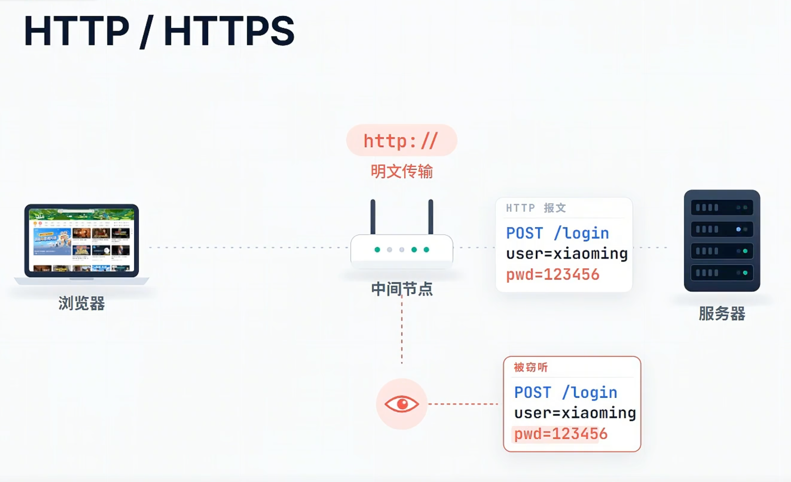

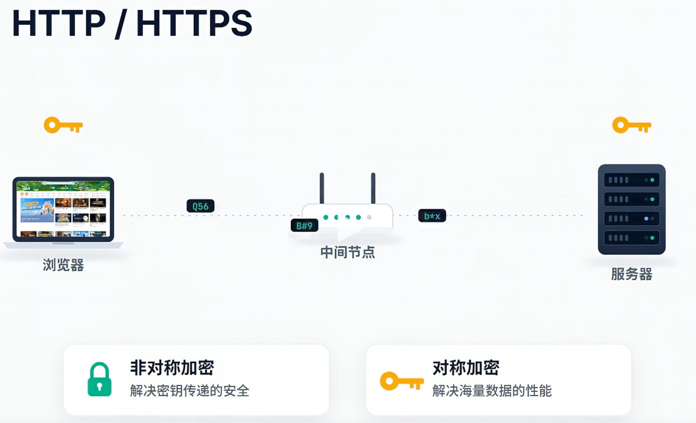
**解决什么问题：** 普通 HTTP 本身不加密传输内容；HTTPS 在保留 HTTP 请求、响应语义的基础上，提供传输加密、完整性保护和通常的服务器身份认证。

**如何工作：** 浏览器连接服务器后，双方通过 TLS 协商密钥等参数。浏览器验证证书链、域名及有效期等信息，再在受保护的通道中交换 HTTP 数据。实际数据通常由对称加密保护；证书和握手用于建立信任与协商密钥。

- HTTP 默认端口是 **80**；HTTPS 默认端口是 **443**，部署时也可使用其他端口。
- HTTPS 上的 HTTP/1.1、HTTP/2 通常使用 **TLS + TCP**。
- **HTTP/3 使用 QUIC，QUIC 基于 UDP，并集成 TLS 1.3 握手。** 不能把 HTTPS 等同于“永远走 TCP”。

**用途与误区：** 网页登录、支付接口、模型 API 都会用到 HTTPS。它保护传输过程，但不能保证网站业务可信，也不能阻止服务器自身泄露数据。TCP 已连接、TLS 握手成功和 HTTP 请求成功，是三个不同阶段。

参考：[HTTP 语义 RFC 9110](https://www.rfc-editor.org/rfc/rfc9110.html)、[TLS 1.3 RFC 8446](https://www.rfc-editor.org/rfc/rfc8446.html)、[HTTP/3 RFC 9114](https://www.rfc-editor.org/rfc/rfc9114.html)。

## 2. DNS：把域名解析为所需记录
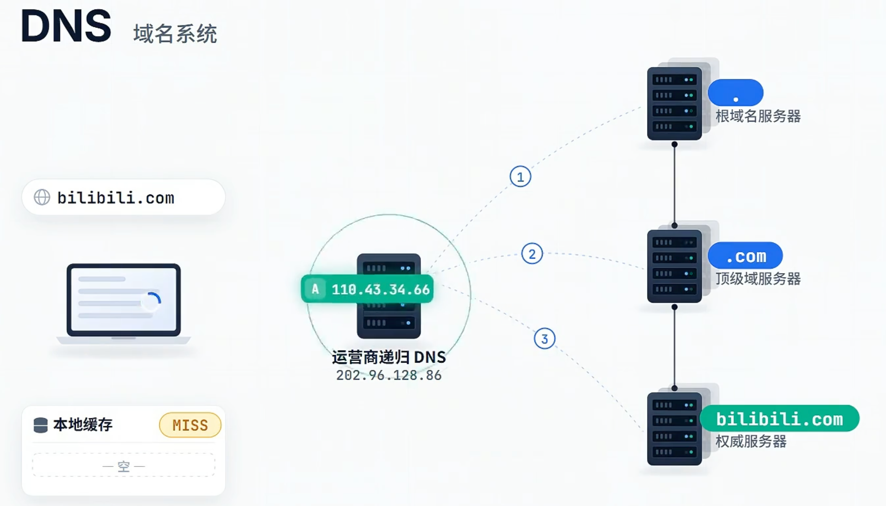

**解决什么问题：** 人更容易记住域名，网络通信则需要 IP 地址等信息。DNS 是分布式、分层的命名系统，不只提供“域名到 IP”的查询。

**典型查询过程：** 以缓存未命中的地址查询为例，设备向递归解析器询问；解析器依次沿根、顶级域、权威服务器的委派关系查找答案，缓存后返回。实际查询可能命中缓存、遇到 CNAME，或由解析器转发给其他解析器，并非每次都从根开始。

- **A / AAAA**：分别记录 IPv4 / IPv6 地址。
- **CNAME**：域名别名，需要继续解析目标名称。
- **MX / NS / TXT**：分别用于邮件交换、权威服务器信息、文本记录等。
- **TTL**：记录可缓存的时间；修改 DNS 后，旧缓存不会立刻全部消失。

传统 DNS 使用 **UDP 或 TCP 的 53 端口**；TCP 并非只用于区域传送。加密 DNS 还包括 DoT、DoH 等方式。

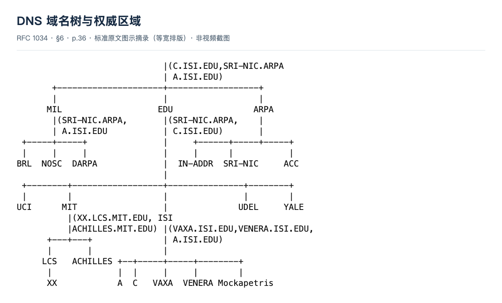

*标准参考截图，非视频截图。来源：[RFC 1034 第 6 节、第 36 页](https://www.rfc-editor.org/rfc/rfc1034.html#section-6)。图示为标准文本的等宽排版摘录；括号标记负责相应区域的名称服务器。图内域名和服务器是历史示例，不代表当前互联网根服务器配置。*

**排查提示：** “域名解析失败”与“服务器端口连不上”不同。先确认 DNS 返回了什么记录，再检查目标地址和服务；直接用 IP 访问 HTTPS 还可能遇到证书域名、SNI 和虚拟主机问题。

参考：[DNS 概念 RFC 1034](https://www.rfc-editor.org/rfc/rfc1034.html)、[DNS 实现 RFC 1035](https://www.rfc-editor.org/rfc/rfc1035.html)、[DNS over TCP RFC 7766](https://www.rfc-editor.org/rfc/rfc7766.html)。

## 3. FTP：通过控制连接和数据连接传文件
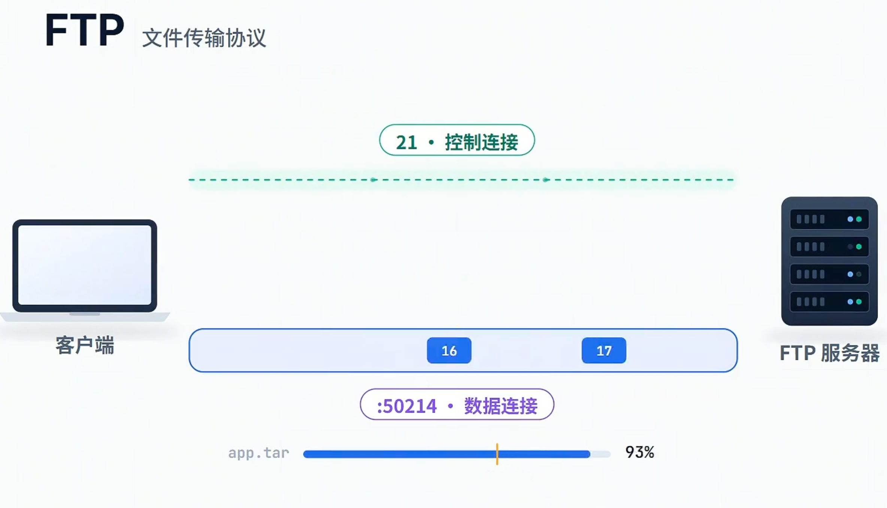
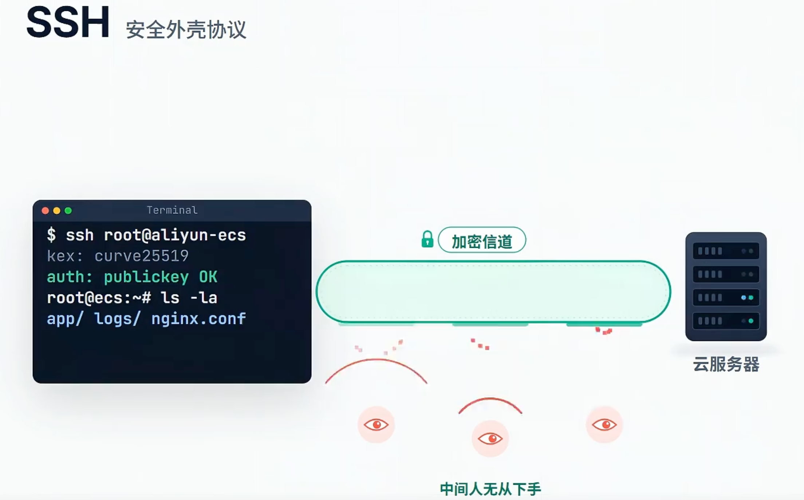

**解决什么问题：** 在客户端与服务器之间上传、下载文件，并执行列目录等操作。FTP 基于 TCP，典型特点是**命令与数据使用不同连接**。

- **控制连接**：客户端连接服务器 TCP **21** 端口，用于登录和发送命令。
- **主动模式**：客户端告知监听端口，服务器主动建立数据连接；传统模式下服务器数据连接通常从 TCP **20** 端口发起。
- **被动模式**：服务器告知一个数据端口，由客户端连接它。服务器需要配置相应端口范围和防火墙规则。

**用途与误区：** 文件交换和一些旧系统仍使用 FTP。普通 FTP 不加密账号、密码和文件内容；**FTPS 是使用 TLS 的 FTP，SFTP 则是运行在 SSH 上的另一种文件传输协议**。不要混为一谈。

“能登录但无法列目录或下载”通常值得检查数据连接、主动/被动模式、防火墙及 NAT 配置，不能只检查 21 端口。

参考：[FTP RFC 959](https://www.rfc-editor.org/rfc/rfc959.html)、[FTP over TLS RFC 4217](https://www.rfc-editor.org/rfc/rfc4217.html)。

## 4. WebSocket：在持久连接上双向发送消息
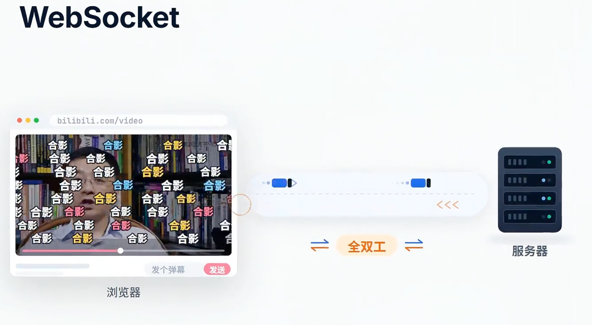

**解决什么问题：** 聊天、协作、行情等场景中，客户端和服务器都需要及时发消息。WebSocket 建立连接后支持全双工通信，减少反复轮询的需要。

**典型建立过程：** 经典 HTTP/1.1 场景下，客户端发送带 `Upgrade: websocket` 的请求；服务器接受后返回 `101 Switching Protocols`，后续在连接中交换 WebSocket 数据帧。HTTP/2、HTTP/3 的引导机制有所不同，不能把 `101` 当成所有版本都必须出现的响应。

- `ws://` 通常使用 **80** 端口；`wss://` 通常使用 **443**，后者有 TLS 保护。
- 协议支持文本帧、二进制帧以及 Ping/Pong、关闭帧。
- 连接中断后的重连、历史消息补发、业务去重，需要应用自己设计。

**与 Agent 的关系：** 双向语音和实时交互可以使用 WebSocket；模型逐字输出也可能用 HTTP 流或 SSE，**看到流式输出不能直接断定使用了 WebSocket**。

参考：[WebSocket RFC 6455](https://www.rfc-editor.org/rfc/rfc6455.html)、[HTTP/2 引导 RFC 8441](https://www.rfc-editor.org/rfc/rfc8441.html)。

## 5. MQTT：通过主题发布和订阅消息
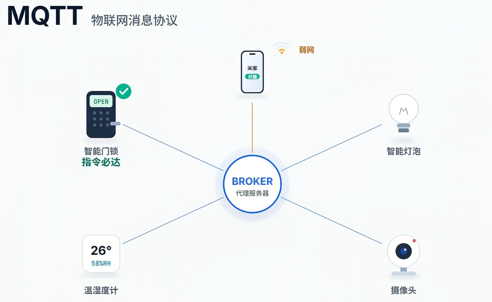

**解决什么问题：** 让设备以较小开销交换消息，并把发送方与接收方解耦。MQTT 常见于物联网，通常运行在 TCP 上。

**三个角色：** 发布者把消息发送到 Broker（消息代理）的某个 Topic（主题）；订阅者订阅主题；Broker 转发匹配的消息。例如温度传感器发布到 `home/room1/temperature`，看板订阅后接收读数。

MQTT 定义三种 QoS：

- **QoS 0，至多一次**：不进行该级别的确认重试，消息可能丢失。
- **QoS 1，至少一次**：通过确认和重传提升交付保障，消息可能重复。
- **QoS 2，恰好一次**：使用额外交互，在协议规定的发送方与接收方交付范围内避免重复。

QoS 2 **不等于整个业务链路只执行一次**。数据库写入、跨系统转发等仍需考虑事务或幂等处理。保留消息可为新订阅者提供某主题最近的保留值；遗嘱消息可用于通知异常断开。

常见端口为 **1883**（普通连接）、**8883**（TLS）。MQTT 也可以通过 WebSocket 承载。

参考：[OASIS MQTT 5.0 标准](https://docs.oasis-open.org/mqtt/mqtt/v5.0/os/mqtt-v5.0-os.html)。

## 6. TCP：提供可靠、有序的字节流
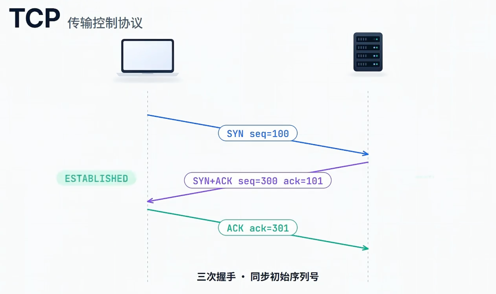

**解决什么问题：** IP 网络中的包可能丢失、重复、乱序。TCP 通过序列号、确认、重传等机制，向应用提供可靠、有序的字节流，并通过流量控制和拥塞控制调节发送速度。

**三次握手：** 以下用 `x`、`y` 表示双方的初始序列号。

1. 客户端发送 `SYN，seq=x`。
2. 服务器回复 `SYN + ACK，seq=y，ack=x+1`。
3. 客户端回复 `ACK，seq=x+1，ack=y+1`。

握手让双方同步序列号并确认连接状态，也降低旧重复报文造成错误连接的风险。SYN 占用一个序列号，所以确认号为初始值加一。

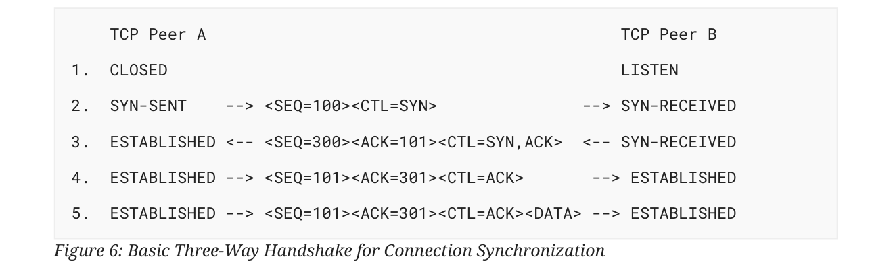

*标准参考截图，非视频截图。来源：[RFC 9293 第 25 页、Figure 6](https://www.rfc-editor.org/rfc/rfc9293.html#figure-6)，从官方 PDF 截取。图中的第 2～4 行是三次握手，第 5 行已经开始携带数据。*

**几个关键区别：** 流量控制避免压垮接收方；拥塞控制避免持续加重网络拥堵。TCP 是字节流，**不保留一次 `send` 对应一次 `recv` 的消息边界**，应用需要长度字段、分隔符等方式切分消息。

关闭连接时，两个方向分别关闭，所以常见“四次挥手”；ACK 与 FIN 可以合并，并非每次抓包都恰好看到四个包。TCP 的可靠性也不意味着网络永久故障时仍能送达，更不意味着对端业务已经处理成功。

参考：[TCP RFC 9293](https://www.rfc-editor.org/rfc/rfc9293.html)。

## 7. UDP：以较少机制发送独立数据报
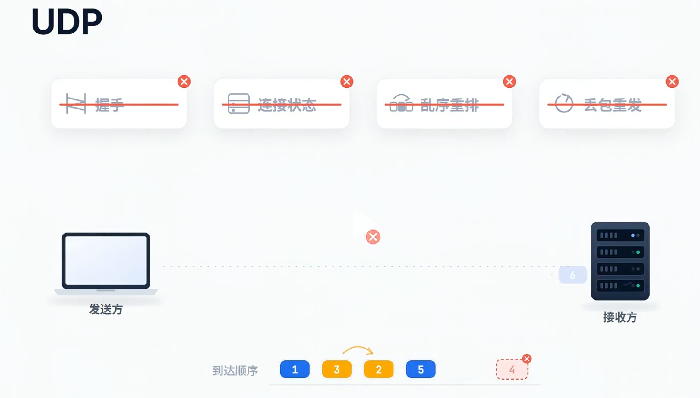

**解决什么问题：** 为应用提供简单的数据报传输。UDP 不要求先建立 TCP 式连接，保留数据报边界，基本首部只有 **8 字节**。

UDP 自身不保证交付、顺序或去重，也不提供 TCP 式重传、流量控制和拥塞控制。应用或上层协议必须按需补上相应机制。

**典型用途：** DNS 查询、实时音视频、游戏状态更新，以及 QUIC 的底层承载。实时业务有时更关心最新状态，晚到的数据可能已经没有价值。

**容易误解的点：** “UDP 更快”不是无条件成立。体验取决于网络、丢包、应用算法等因素。**基于 UDP 也可以实现可靠传输**，例如 QUIC 可靠流；可靠性由上层机制提供，而非 UDP 自带。

参考：[UDP RFC 768](https://www.rfc-editor.org/rfc/rfc768.html)、[QUIC RFC 9000](https://www.rfc-editor.org/rfc/rfc9000.html)。

## 8. IP：让数据包跨网络到达目的地址
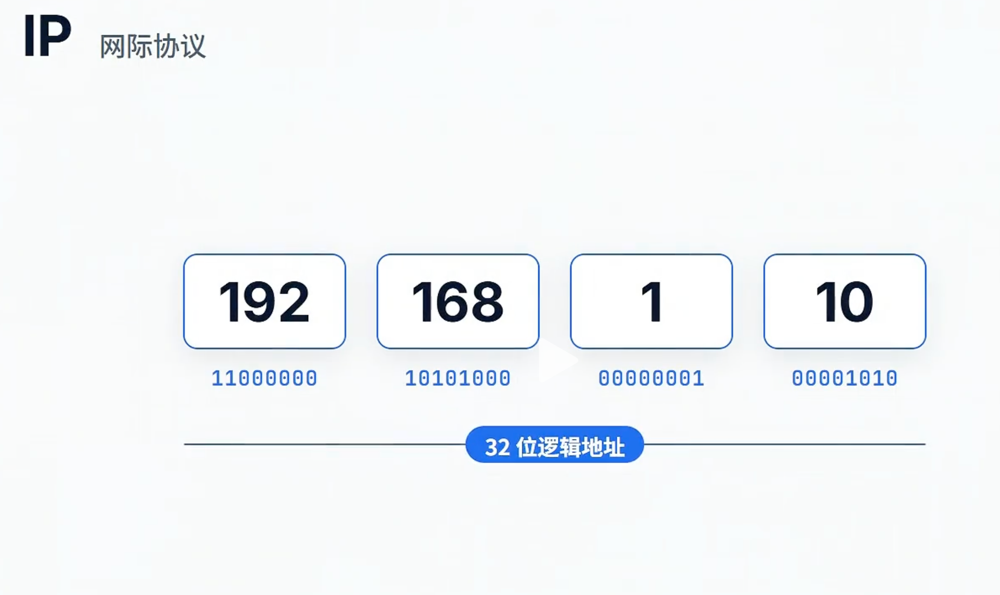

**解决什么问题：** 为主机或接口提供逻辑地址，并支持路由器根据目的地址逐跳转发数据包。IP 提供尽力而为的交付，不保证包必达、按序到达或只到达一次。

- **IPv4** 地址为 32 位，例如文档示例地址 `192.0.2.10`。
- **IPv6** 地址为 128 位，例如文档示例地址 `2001:db8::10`。
- **前缀长度**描述网络范围，例如 `192.168.1.0/24`；主机通过路由表决定直接发送还是交给网关。
- 路由器通常按**最长前缀匹配**选择路由。IPv4 TTL、IPv6 Hop Limit 在转发时递减，避免数据包无限循环。

**与 TCP/UDP 的关系：** IP 负责网络寻址与转发；TCP/UDP 的端口用于区分传输端点。只知道服务器 IP，还不知道要连接哪个服务。

IPv4 与 IPv6 的分片规则不同：IPv4 在条件允许时可由中间路由器分片；IPv6 路由器不执行分片，需要由源节点处理。

参考：[IPv4 RFC 791](https://www.rfc-editor.org/rfc/rfc791.html)、[IPv6 RFC 8200](https://www.rfc-editor.org/rfc/rfc8200.html)。

## 9. ICMP：反馈网络状态和转发错误
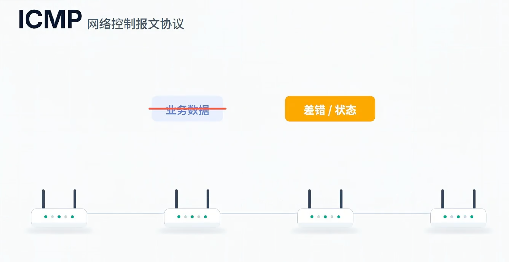

**解决什么问题：** 让主机和路由器报告某些网络问题，例如目的不可达、TTL 超时。ICMP 直接承载在 IP 中，**没有 TCP/UDP 意义上的端口**。

- `ping` 通常利用 Echo Request / Echo Reply 测试可达性和往返时延。
- `traceroute` 通过逐步增大 TTL/Hop Limit，观察中间节点返回的超时消息；探测包可能使用 UDP、ICMP 或 TCP，取决于实现和参数。
- 路径 MTU 发现依赖相应控制消息；IPv6 中的 Packet Too Big 尤其重要。

**排查误区：** Ping 不通可能只是 ICMP 被过滤或限速，并不一定表示网页不可访问；Ping 通也不能证明 TCP 443、TLS、HTTP 或业务逻辑正常。ICMP 负责反馈，不负责替应用重传数据。

参考：[ICMPv4 RFC 792](https://www.rfc-editor.org/rfc/rfc792.html)、[ICMPv6 RFC 4443](https://www.rfc-editor.org/rfc/rfc4443.html)。

## 10. BGP：在自治系统之间交换可达性信息
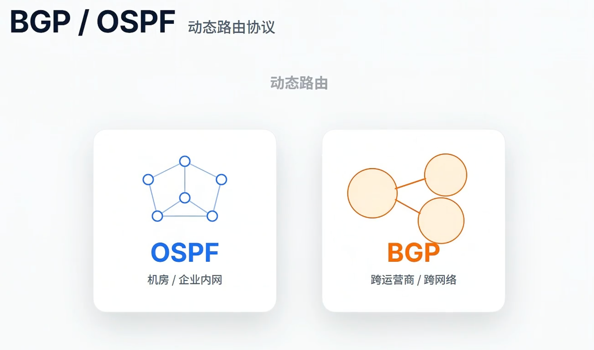

**解决什么问题：** 互联网由许多自治系统（AS）互联组成。BGP 让运营商、云厂商等网络交换“哪些 IP 前缀可以通过我到达”的信息。

**如何工作：** BGP 邻居通过 **TCP 179** 建立会话，交换路由通告和撤销信息。路由携带 AS_PATH 等属性，网络结合属性和本地策略选择路径。

- **eBGP**：用于不同 AS 之间交换路由。
- **iBGP**：用于同一 AS 内传播 BGP 路由信息。
- AS_PATH 可帮助识别经过的 AS，并用于避免某些路由环路。

**重点：** BGP 的选路受策略影响，不能理解为始终选择物理距离最近、延迟最低或 AS 数最少的路径。商业关系、本地优先级等都可能影响结果。

当某条路由被撤销，网络需要重新选择可用路径；普通 HTTP 请求不会临时发起一次 BGP 查询。BGP 主要作用于路由控制，数据包仍按已有转发表转发。

参考：[BGP-4 RFC 4271](https://www.rfc-editor.org/rfc/rfc4271.html)。

## 11. OSPF：在自治系统内部计算路径

**解决什么问题：** 在企业或运营商的内部网络中，让路由器根据拓扑变化自动学习和更新路径。正确拼写是 **OSPF（Open Shortest Path First）**，不是 QSPF。

**典型过程：** 路由器通过 Hello 等交互发现邻居，建立所需邻接关系，交换链路状态信息；在区域范围内形成一致的链路状态数据库，再以自身为根运行 SPF 算法计算路径。

- 路径选择依据累计 **Cost**，不是简单地“经过路由器最少”。
- 网络可划分为多个 Area；骨干区域通常是 **Area 0**。
- OSPF **直接运行在 IP 之上，IP 协议号为 89**，不是 TCP/UDP 的 89 端口。

**与 BGP 的区别：** OSPF 重点解决域内的拓扑和路径计算；BGP 重点解决跨 AS 的可达性与策略传播。两者可以配合工作，不能相互简单替代。

参考：[OSPFv2 RFC 2328](https://www.rfc-editor.org/rfc/rfc2328.html)。

## 12. DHCP：自动分配网络配置
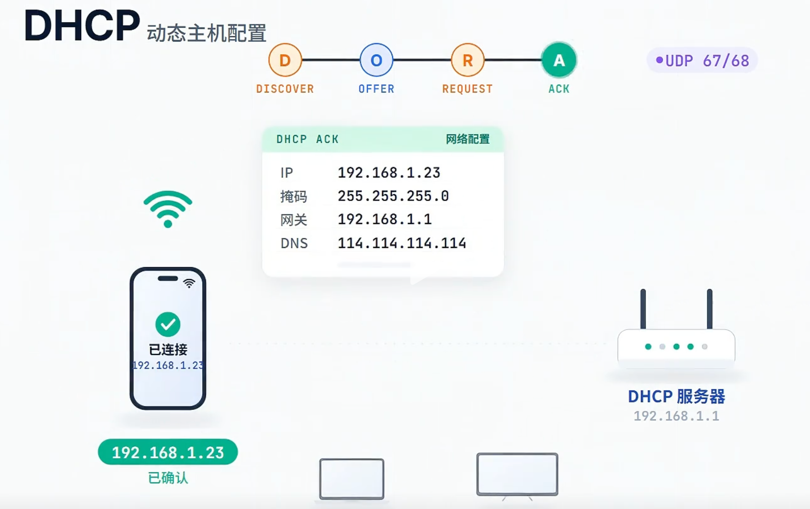

**解决什么问题：** 设备接入网络时，自动获得 IP 地址、子网掩码、默认网关、DNS 服务器等配置，减少逐台手工设置。以下介绍 **DHCPv4**。

首次获取地址的典型交互称为 **DORA**：

1. **Discover**：客户端寻找可用的 DHCP 服务器。
2. **Offer**：服务器提出可提供的地址和配置。
3. **Request**：客户端请求使用选中的配置。
4. **ACK**：服务器确认租约和配置。

服务器使用 **UDP 67**，客户端使用 **UDP 68**。客户端初次请求通常依赖广播；跨网段部署可以借助 DHCP Relay 转发。

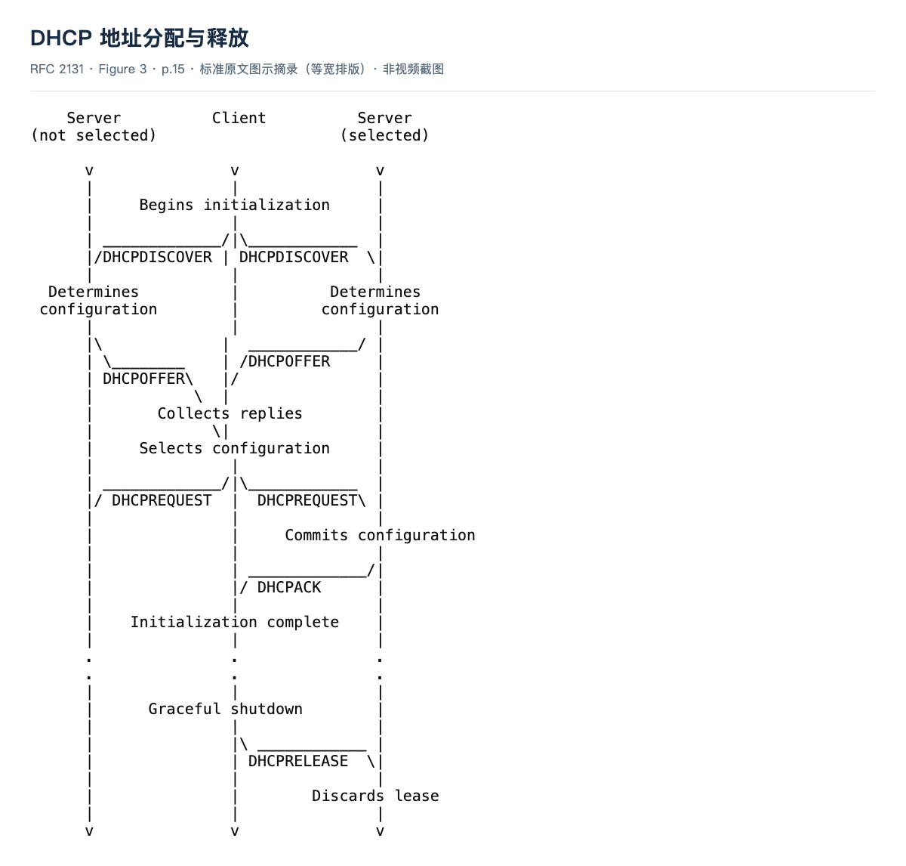

*标准参考截图，非视频截图。来源：[RFC 2131 第 15 页、Figure 3](https://www.rfc-editor.org/rfc/rfc2131.html#section-3.1)，标准文本等宽排版摘录。中间是客户端，两侧是服务器；客户端选择其中一个 Offer。图的下半部分还演示了主动释放租约。*

**重点：** DHCP 分配的是有期限的租约，后续需要续租。续租不一定重走完整 DORA，也不一定广播。DHCPv6 的消息、端口及工作方式不同；IPv6 还可以使用 SLAAC，不能把这里的四步原样套过去。

参考：[DHCP RFC 2131](https://www.rfc-editor.org/rfc/rfc2131.html)。

## 13. NAT：转换地址，必要时也转换端口
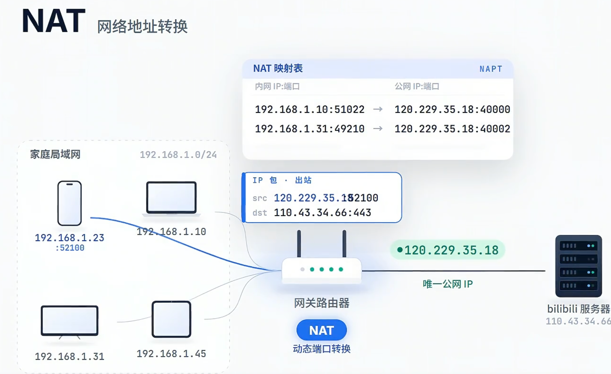

**解决什么问题：** 让使用私有地址的网络与外部网络通信。常见家庭路由器不仅转换 IP 地址，还转换端口，使多台设备共享一个外部 IPv4 地址；这种形式称为 **NAPT/PAT**。

**示例：** 手机发送的连接源地址为 `192.168.1.10:53000`，路由器可将其映射为 `203.0.113.5:62001`。外部响应到达该映射后，路由器依据状态还原目的地址并转发给手机。这里的外部地址仅用于文档举例。

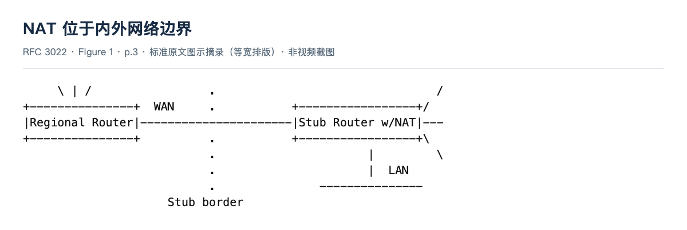

*标准参考截图，非视频截图。来源：[RFC 3022 第 3 页、Figure 1](https://www.rfc-editor.org/rfc/rfc3022.html#section-2)，标准文本等宽排版摘录。图中的 NAT 位于内外网络边界；该图展示部署位置，不是具体的端口映射表。*

**容易混淆的点：** NAT 是转换机制，不是与 TCP 并列的传输协议。它不是加密，也不能等同于防火墙。没有合适映射时，外部设备通常无法直接主动访问内部服务；端口映射、穿透或中继可以解决不同场景的问题。

NAT 状态可能因超时失效，所以长连接需要合理的心跳与重连机制。IPv6 的大地址空间减少了依赖 NAT 节省地址的需要，但仍然需要访问控制。

参考：[传统 NAT RFC 3022](https://www.rfc-editor.org/rfc/rfc3022.html)。

## 14. ARP：在本地链路上找到下一跳 MAC 地址
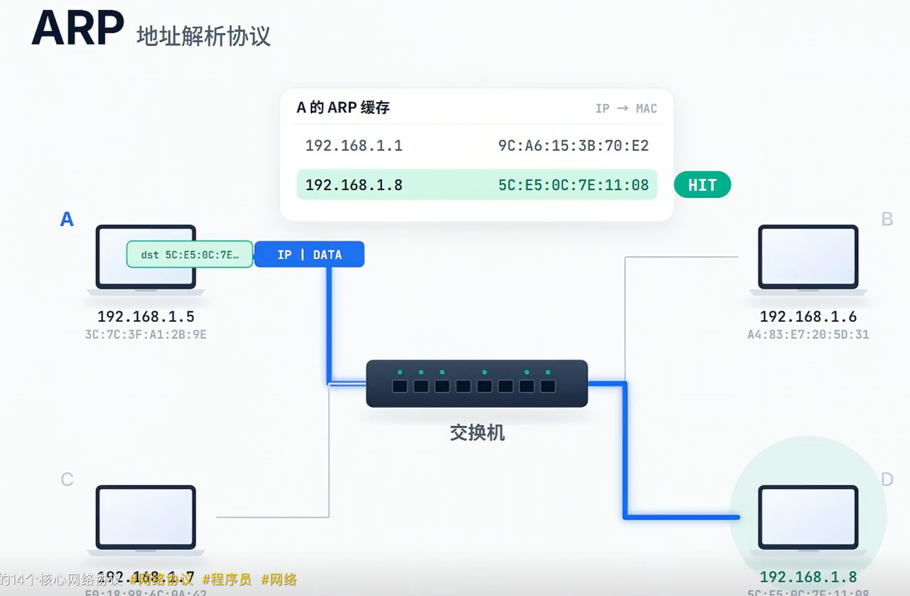

**解决什么问题：** 在常见 IPv4 以太网中，主机已经知道下一跳的 IPv4 地址，却还不知道以太网帧应发给哪个 MAC 地址。ARP 用于解析这组映射。

**典型过程：** 主机检查 ARP 缓存；未命中时，在本地广播询问目标 IPv4 地址对应的 MAC；拥有该地址的设备通常单播回复，发送方缓存结果后封装以太网帧。

**最重要的边界：** 如果目标位于同一子网，通常解析目标主机的 MAC；如果目标在远端网络，则解析**下一跳网关的 MAC**。不会向本地广播询问远端互联网服务器的 MAC。

例如访问外网时，IP 包的目的地址是远端服务器，而发出的本地以太网帧目的 MAC 可以是家庭路由器。经过路由器后，下一段链路会重新封装链路层头部。

ARP 不经由 TCP/UDP，广播通常不跨路由器传播。IPv6 使用基于 ICMPv6 的邻居发现机制（NDP），不使用 ARP。

参考：[ARP RFC 826](https://www.rfc-editor.org/rfc/rfc826.html)、[IPv6 邻居发现 RFC 4861](https://www.rfc-editor.org/rfc/rfc4861.html)。

## 把它们串起来：打开一个 HTTPS 网页

以下以“家庭 IPv4 网络、动态配置地址、使用 HTTP/2”的典型场景解释。它是帮助理解的流程，缓存、连接复用和实际网络配置会省去或改变部分步骤。

1. **先获得网络配置**：连接 Wi-Fi 后，DHCP 提供本机地址、默认网关和 DNS 服务器等信息。
2. **解析域名**：浏览器需要目标地址时通过 DNS 查询；已有有效缓存时可直接使用。
3. **把包交给本地下一跳**：若 DNS 服务器或网站位于外网，设备先按路由选择网关，再在需要时通过 ARP 获取网关 MAC。因此 ARP 也可能发生在 DNS 查询发送之前。
4. **跨网络转发**：IP 数据包经路由器逐跳前进；家用路由器可能进行 NAT。网络中的转发表由直连、静态路由、OSPF、BGP 等预先建立和持续维护。
5. **建立传输连接**：浏览器与目标服务建立 TCP 连接。一次真实连接的 TCP 报文同样要经过上述 IP、链路和可能的 NAT 转发。
6. **建立安全通道并请求页面**：TLS 握手完成后，浏览器发送 HTTP 请求，服务器返回响应。若实际协商的是 HTTP/3，则使用 QUIC/UDP 的路径。
7. **处理后续交互与故障**：双向实时交互可按需使用 WebSocket；网络设备可能通过 ICMP 反馈部分问题。

FTP、MQTT 是其他应用场景中的选择，并不要求每次打开网页都出现。**这些机制是分层配合、按需参与，不是 14 道固定串行工序。**

## 面向 Agent 和接口测试，怎么用这些知识

调用模型或工具失败时，先根据证据定位阶段：

- **名称解析阶段**：检查域名、DNS 返回值、缓存、代理的解析位置。
- **连接阶段**：区分连接超时与被拒绝，检查目标地址、端口、路由、防火墙和代理。
- **TLS 阶段**：检查证书有效性、域名匹配、信任链、系统时间及协议兼容性。
- **HTTP 阶段**：收到 401、403、429、5xx 时，已经有某个 HTTP 节点返回响应；结合响应头和日志判断是网关、代理还是目标服务。
- **流式会话阶段**：检查连接空闲超时、代理缓冲、心跳、断线重连和消息补发，不要一看到“中断”就认定是模型问题。
- **业务执行阶段**：传输成功不代表工具执行成功；重试创建订单、写数据等操作前，要考虑幂等性，避免重复副作用。

可以在 macOS / Linux 中按需运行以下只读检查。将示例域名换成待排查目标；不同环境可能需要安装相应工具。

```bash
# 查询 DNS 地址记录
dig example.com A
dig example.com AAAA

# 查看 HTTPS 请求的连接与握手信息
curl -vI --connect-timeout 5 https://example.com

# 辅助观察 ICMP 可达性；失败不等于 HTTPS 不可用
ping -c 4 example.com

# 查看本机已有的 IPv4 ARP 缓存
arp -a
```

`curl -I` 发出的是 HEAD 请求，不能替代真实业务请求的完整测试；某些服务对 HEAD 与 GET 的处理不同。

## 复习时记住这些区别

1. **DNS 解决名称查询，ARP 解决本地下一跳地址解析。**
2. **IP 负责尽力转发，TCP 在其上提供可靠字节流。**
3. **UDP 自身不保证可靠，上层仍可实现可靠传输。**
4. **HTTPS 不保证永远走 TCP；HTTP/3 使用 QUIC/UDP。**
5. **BGP 侧重跨域策略和可达性，OSPF 侧重域内拓扑和路径计算。**
6. **DHCP 分配配置，NAT 转换地址，ICMP 反馈网络问题。**
7. **长连接、传输确认、业务成功、业务只执行一次，是不同层次的保证。**

## 截图与来源说明

图片保存在本文同目录的 `images/network-protocols/` 中，使用相对路径引用，随笔记一起移动时请保留该目录。

- `dns-domain-tree.png`：RFC 1034，第 36 页，第 6 节域名树图示。
- `tcp-three-way-handshake.png`：RFC 9293，第 25 页，Figure 6，PDF 图示截图。
- `dhcp-address-allocation.png`：RFC 2131，第 15 页，Figure 3。
- `nat-border-router.png`：RFC 3022，第 3 页，Figure 1。

DNS、DHCP、NAT 图片取自 IETF 标准文本版的原始图示，保留等宽布局，摘录排版后通过浏览器截图；TCP 图片直接截取官方 PDF。所有图片均为**协议标准参考图，不是视频画面，也不是实际抓包结果**。标准中的历史地址和拓扑仅用于理解机制。各节链接提供进一步核对入口。

