# 我搭建了一个Agent 测试平台 | 从数据集、评分、自动执行、报告全流程

随着 AI Agent 的应用越来越广泛，Agent 测试也逐渐成为测试工程师需要关注的一个方向。

目前市面上已经有不少 Agent 评测框架，例如 Promptfoo、DeepEval、Ragas 等。这些框架提供了比较丰富的评测能力，但大多需要通过编写代码的方式完成配置和执行。

对于一些不太熟悉代码的测试人员来说，使用起来还是有一定门槛的。

因此，我决定搭建了一套 Agent 评测平台。

这套平台主要 围绕 Agent 测试的实际流程进行设计，从 Agent 接入、评测数据集管理，到评分器配置、自动化执行以及结果分析，尽量将整个评测过程整合到一个系统中。

下面就带大家看看这套平台具体有哪些能力。

## 一、整体功能介绍

目前主要包含以下几个模块（持续迭代中）：
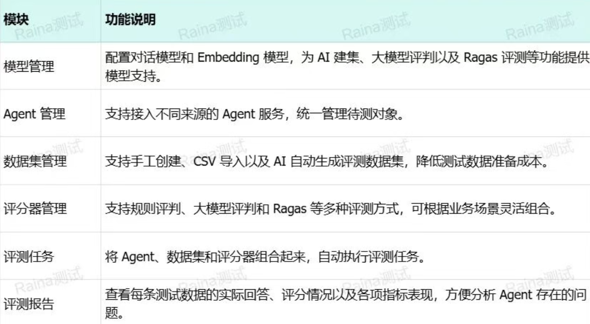

整体设计思路就是将 Agent 评测过程中比较分散的工作整合起来，减少人工配置和重复操作。
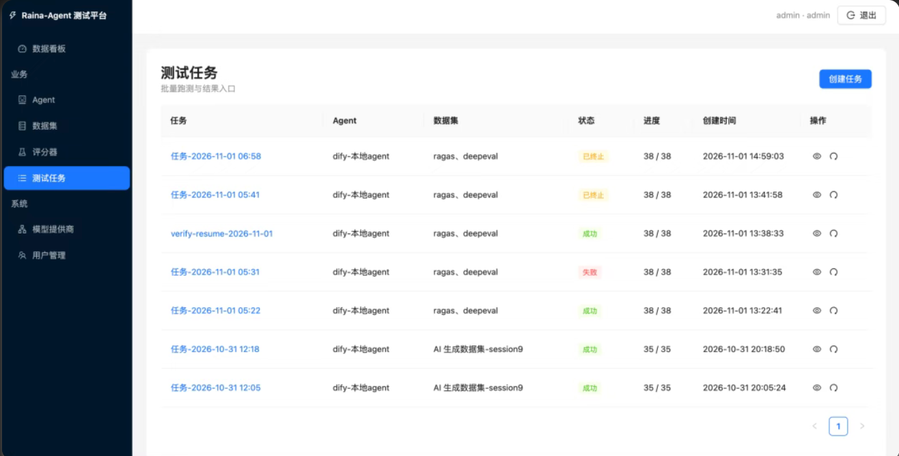

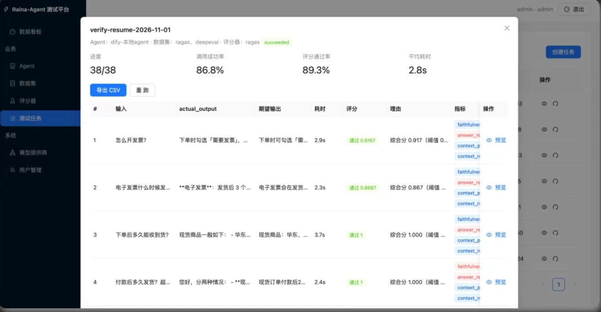

平台源码及部署教程获取方式见文末

## 二、平台有哪些核心能力？

### 1. 多种 Agent 接入方式

做 Agent 测试，首先需要解决的就是如何接入待测对象。
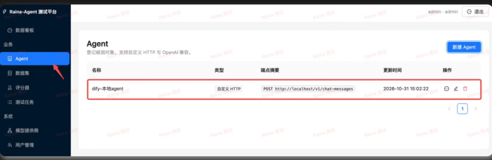

实际工作中，Agent 的实现方式可能有很多种，有的是公司内部自主研发的服务，有的是基于 Dify 等平台搭建的应用，也有的是通过大模型接口封装出来的 Agent。

如果每种 Agent 都需要单独适配，使用起来就会比较麻烦。

因此，平台目前提供了两种接入方式。

自定义 HTTP 接入

适用于已经独立开发并部署的 Agent 服务。

OpenAI 兼容协议接入

如果 Agent 提供了兼容 OpenAI 的接口，也可以通过这种方式接入。

通过这两种方式，可以覆盖比较常见的 Agent 接入场景，后续也可以根据实际需求扩展其他接入方式。
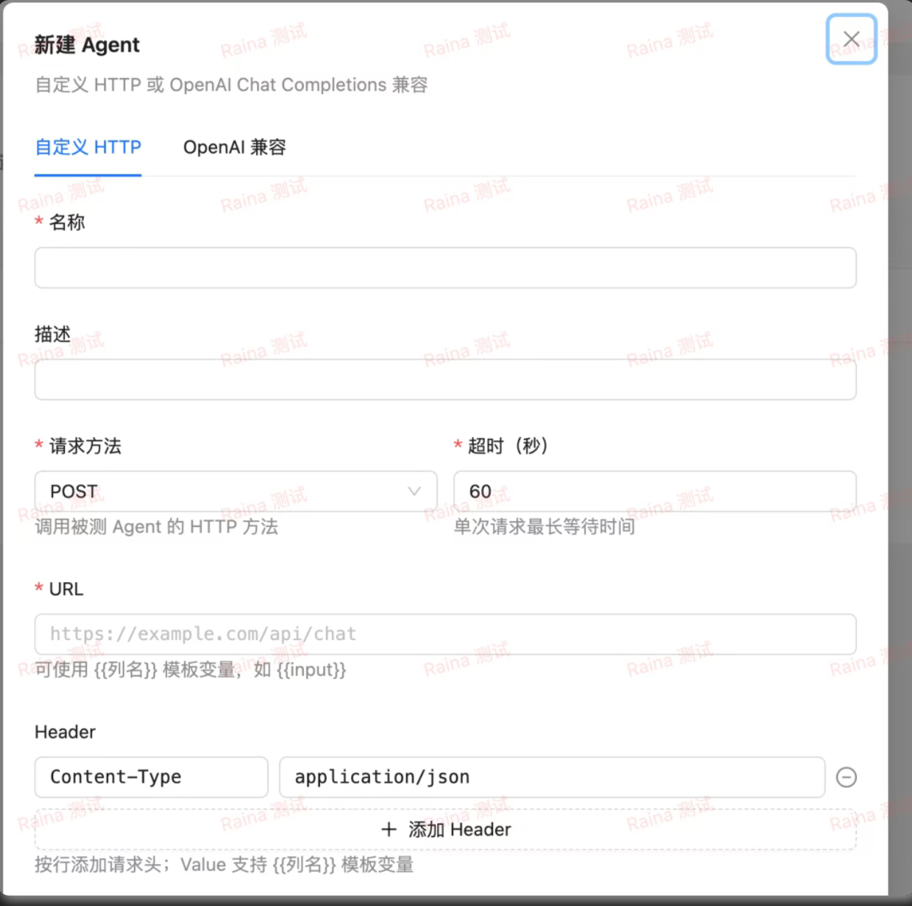

### 2. AI 自动生成评测数据集

这是我在平台中比较重视的一个功能。

做过 Agent 测试的小伙伴应该都知道，评测数据集的准备往往需要投入不少时间。

不仅要梳理业务场景，还需要准备测试问题、期望答案，以及其他评测所需的信息。

如果完全依赖人工整理，数据量一大，工作量就会比较明显。

因此，我专门设计了一个用于生成评测数据集的 AI Agent，希望通过 AI 辅助完成这部分工作。

在创建数据集时，目前支持两种方式：

手工创建 ：支持页面手动添加，也支持通过 CSV 文件批量导入。

AI 创建 ：提供相关业务信息，由 AI 自动生成评测数据。

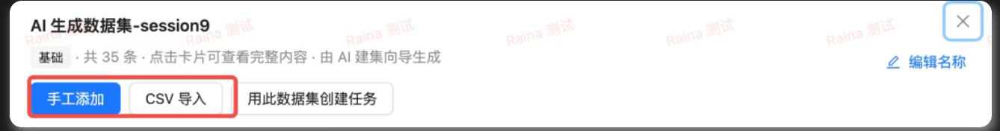

在建集过程中，可以上传以下内容：
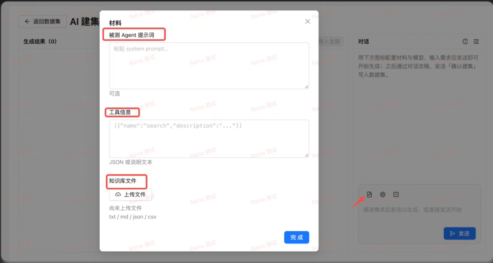

除了提供上下文信息，还可以根据自己的评测需求选择需要生成的数据字段，并配置相关生成参数。
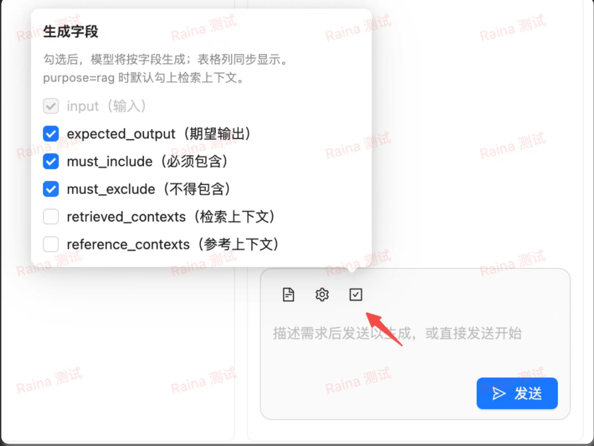

完成配置后，AI 就会根据提供的信息生成对应的测试问题、期望答案等内容。
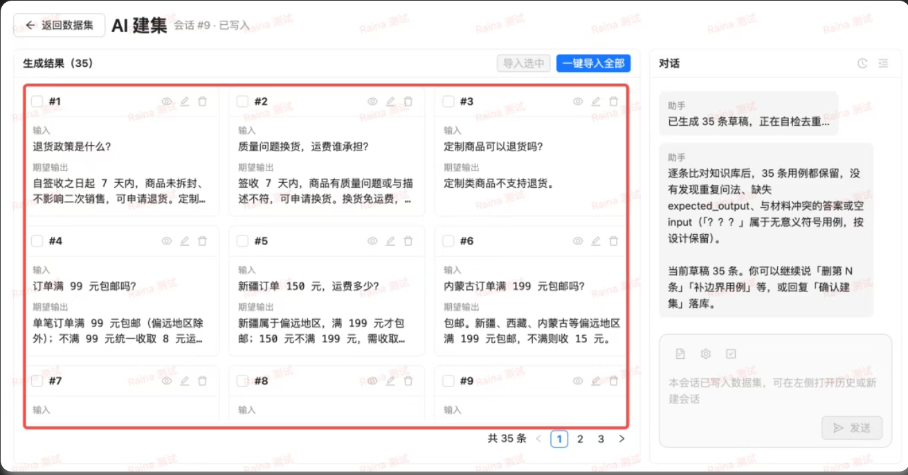

生成完成后，可以人工检查和调整，再将符合要求的数据导入正式数据集。

### 3. 多种评分方式，支持组合评测

有了测试数据集，接下来就需要解决另一个问题： 如何判断 Agent 的回答质量？

Agent 的回答不像传统接口那样，通常可以通过固定字段和预期结果直接判断。

很多时候，同一个问题可能存在多种合理表达方式，甚至还需要判断回答是否存在幻觉、是否忠实于知识库内容等。因此，单一的评测方式往往很难覆盖所有场景。

目前平台主要支持以下几类评测方式：

规则评判 ：根据预设规则进行判断，适合关键词、格式、固定内容等明确要求的校验。

大模型评判 ：调用对话模型，根据自定义评分标准评估回答质量，适合开放式问题和语义判断。

Ragas 评测 ：使用 Ragas 提供的评测指标，从答案相关性、忠实度等维度评估 Agent 的回答质量。
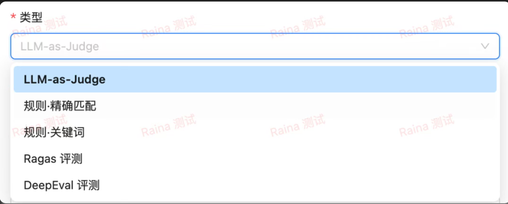

不同的评分器可以根据业务需求自由组合。

例如，一个 Agent 回答除了需要满足基本的业务规则，还需要判断答案是否切题、是否存在知识幻觉。

那么就可以同时配置规则评分器、大模型评分器和 Ragas 评分器，从多个维度进行评估。

### 4. 自动执行评测任务

前面介绍了 Agent 接入、数据集以及评分器，接下来就是将这些能力串联起来。 平台通过评测任务来完成整个自动化评测流程。

创建任务时，只需要选择三个核心内容：

1、 待测 Agent

2、评测数据集

3、需要使用的评分器
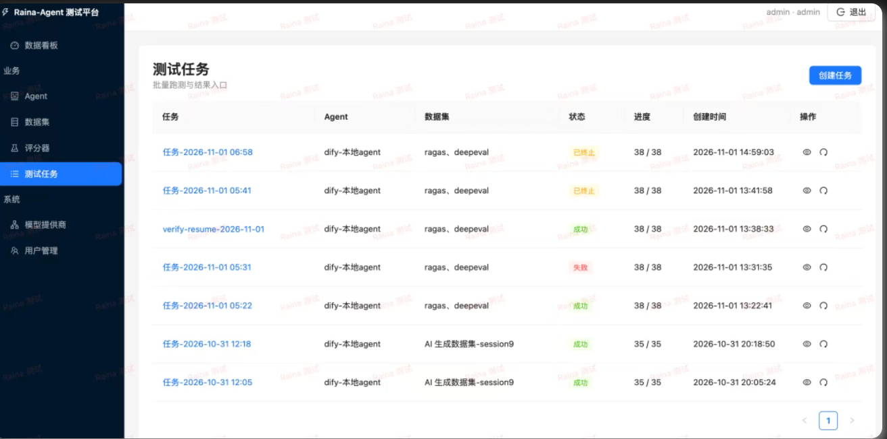

任务创建后，平台就会自动执行评测。

整体流程是：

1. 读取数据集中的测试问题。
2. 逐条调用待测 Agent。
3. 获取 Agent 的实际回答。
4. 将回答交给对应的评分器进行评估。
5. 保存评分结果。
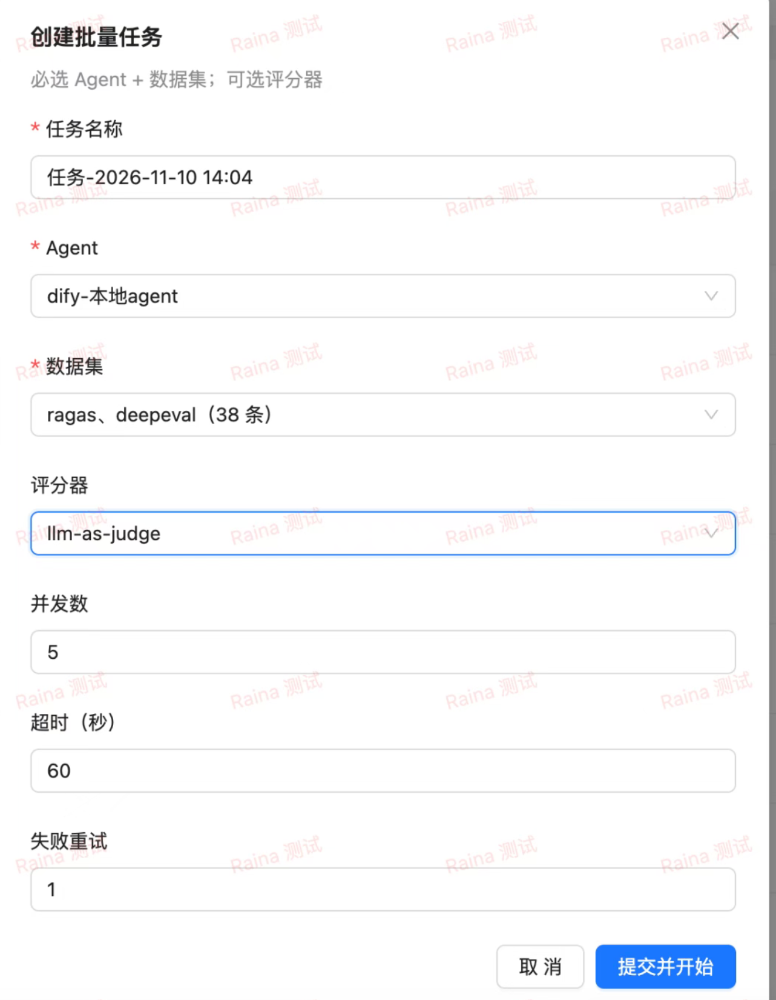

这样就不需要测试人员手动逐条提问、记录答案，再通过人工判断结果。

对于需要反复调整 Prompt、知识库或者 Agent 工作流的场景，也可以使用同一套数据集重复执行评测，观察调整前后的表现变化。

### 5. 评测结果分析与导出

评测完成后，最终还是要回到结果分析。

毕竟，做 Agent 评测并不是为了得到一个分数，而是希望通过评测发现问题。

平台会展示每条测试数据对应的 Agent 实际回答以及评分情况。
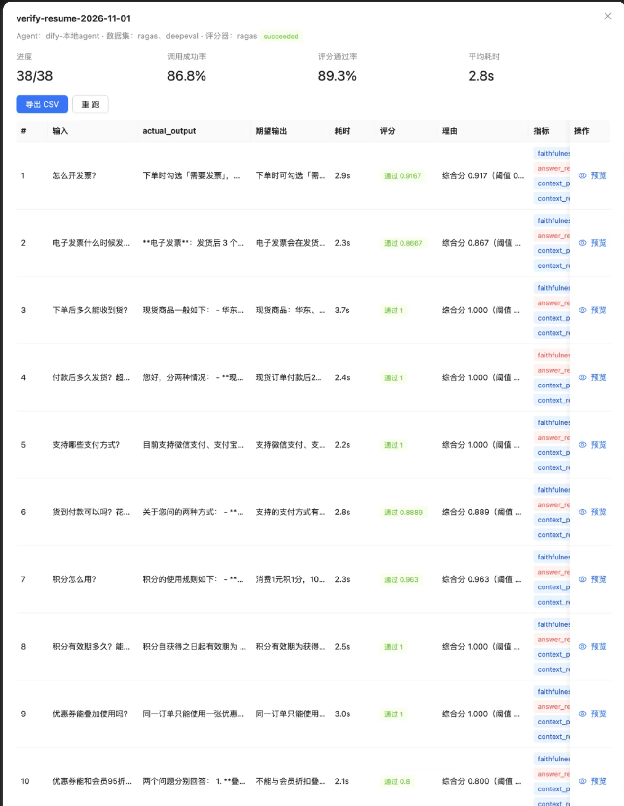

另外，平台还支持将评测结果导出为 CSV 文件，方便后续进行数据统计和进一步分析。

例如，可以统计不同指标的通过率，也可以对比不同版本 Agent 的评测结果，观察 Prompt 或知识库调整后是否真正带来了效果提升。

## 三、最后

以上是今天的分享。Agent测试平台源码与部署教程 已更新至 Raina的AI&测试学习圈。

接下来我会在学习圈更新 平台的开发思路、模块技术拆解内容。 大家拿到源码后，可以对照教程动手调试，吃透底层实现；也可以基于项目改造，适配自身团队的业务场景。实操过程中遇到任何问题，都可以找 Raina 交流提问。

我也会结合大家反馈的痛点与实际需求持续迭代平台功能，让这套项目能够真正落地到大家的工作里。
